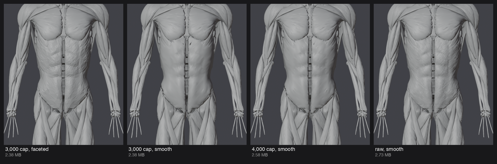

# 3D 解剖图：可行性结论与 spike

> 状态：调研完成（2026-11-18）；独立 viewer 与 NSH WebView spike 已完成
> （2026-11-20），模拟器截图见 `design/prototypes/anatomy-3d/screenshots/app-*.png`；
> 目标真机的帧率、发热与内存仍待实测。
> 深度报告与逐条映射：`docs/research/z-anatomy-feasibility.md`、`docs/research/z-anatomy-site-map.csv`；
> Human Atlas 对照：`docs/research/human-atlas-feasibility.md`、`docs/research/human-atlas-site-map.csv`。

> 视觉刷新（2026-11-25）：首屏「全白」的根因是 8 位主题 token（`#6ee7f0ff`）
> 被 `THREE.Color` 解析成白色；viewer 现在统一在着色入口把颜色收成 6 位。
> 同一轮把正常肌肉改为暖象牙、异常改为珊瑚红，去掉左右半身色；顶部摘要、
> 编号标记、按严重度排序的异常清单、详情卡避让与深层提示也一起落地。
> 取舍与验收清单见 `docs/handoffs/2026-11-25-anatomy-3d-visual-refresh.md`，
> 视觉原型见 `design/prototypes/anatomy-3d-refresh.html`。真机帧率/发热仍未测。

## 为什么转向 3D

2D 身体图已经能回答「哪个区域需要先处理」，但原型没有达到预期：躯干与深层肌肉（腹横肌、多裂肌、腰方肌）在 2D 上只能靠色块和文字解释，遮挡关系与左右分层不直观。3D 值得做的理由不是「能转」，而是：

- 背面与深层结构可见；
- 左右分开着色；
- 可以剥离浅层，露出深层核心肌；
- 点击能落到单块肌肉，而不是肌群。

如果 spike 证明用户只用旋转、不看深层，那 3D 的性价比不成立，应回到 2D。

## 数据源：Z-Anatomy 单源（Human Atlas 备选）

2026-11-18 的补充调研推翻了「Human Atlas 为主 + Z-Anatomy 补 6 块」的结论。原因不是 Human Atlas 不好，而是**补缺一旦发生，许可优势就消失了**：混合方案整体已经是 CC BY-SA 4.0，而 Z-Anatomy 单源覆盖更全、管线更简单、体积更小。

实测 [Z-Anatomy](https://github.com/Z-Anatomy/Models-of-human-anatomy)（CC BY-SA 4.0，上游 BodyParts3D CC-BY-SA 2.1 Japan）：

- `.blend` 306 MB，4,569 个网格、410 万三角面、1,944 个 collection；这是 Blender 图谱模板，不是移动端资产。
- 我们的 119 个 site 子集：**79/79 块肌肉、31/40 个骨骼部位**，另 9 个骨性标志有自带定位点；共 311 个对象、1,467,016 原始三角面。
- 清掉 custom split normals、全面 smooth 后：原始几何 **1,502,535 渲染三角面、Draco GLB 2.73 MB**；每对象 3,000 面上限是 **743,912 面、2.38 MB**；每对象 1,500 面上限是 **432,790 面、1.70 MB**。左右共享 mesh，311 个节点。
- 线性简化会让腹直肌出现块面感；smooth shading 能消掉块面，但 2,000–4,000 面档会丢掉肌肉纤维起伏。**原始几何 + smooth 是「效果最好、体积仍小」的交点，只比 4,000 面档大 0.15 MB。**

- 不需要补 6 块肌肉、不需要镜像右侧颈长肌；78 块肌肉左右成对，膈肌中线。

对比 Human Atlas 混合方案：

| 方案 | 覆盖 | 渲染面 | Draco | 许可 |
|---|---:|---:|---:|---|
| Human Atlas + Z-Anatomy 补 6 块 | 79/79 | 476,290 | 2.51 MB | CC BY-SA 4.0 |
| **Z-Anatomy 单源 + 原始几何 + smooth** | **79/79** | **1,502,535** | **2.73 MB** | **CC BY-SA 4.0** |
| Z-Anatomy 单源 + 3,000 面上限 + smooth | 79/79 | 743,912 | 2.38 MB | CC BY-SA 4.0 |
| Z-Anatomy 单源 + 1,500 面上限 | 79/79 | 432,790 | 1.70 MB | CC BY-SA 4.0 |
| hpfrei 简化版 | 75/79 | 143,520 | 0.92 MB | CC BY-SA 4.0（只做原型） |

Human Atlas 仍有价值：单块肌肉更平滑、许可更干净（CC BY 4.0）。如果法务不接受 share-alike，就回到「Human Atlas + 自制 6 块低模」，但工作量和覆盖都更差。

许可后果不变：只要模型里有一块来自 Z-Anatomy，导出的 3D 资产就必须按 **CC BY-SA 4.0** 共享。App 代码可以闭源，但模型资产及修改要 share-alike。

## Z-Anatomy 的缺口与坑

### 肌肉

- 79/79 全覆盖；但命名是 TA2 变体：`Semispinalis capitis` 叫 `Spinalis capitis muscle`，`External oblique` 叫 `External abdominal oblique muscle`，`Gemellus` 词序相反。
- 肌肉常按部位拆分（长头/短头、三个部分、三个节段），必须做并集；不能假设「一个对象 = 一块肌肉」。
- 1,605 个 0 面辅助对象、705 个起点/止点面片、1,660 个文字标签、951 条引线，导出前必须过滤。

### 骨骼

- 31/40 有真实网格；颈/胸/腰椎、肋骨、腕骨、跖骨是集合区域，合并子网格。
- 9 个部位只有 `.j` 两顶点定位点：肩峰、喙突、关节盂、髂骨、坐骨、耻骨、ASIS、PSIS、大转子。定位点在模型的 −X 侧，与 `.l` 网格镜像；用之前要 X 取反。
- 定位点到父骨表面 0.7–3.6 cm，是标签锚点，不是骨面点。用「父骨淡色 + 标记点」，不要做整块骨染色。

## 渲染与嵌入

NSH 原生没有 3D 网格管线：`Canvas` 是 2D，`Shader` 是覆盖一个盒子的 WGSL fragment shader，没有顶点/深度/网格管线。真 3D 只有两条路：

| 方案 | 3D | 性能 | 离线 | 代价 |
|---|---|---|---|---|
| WebView + Three.js | 是 | 中上，需真机实测 | 可以 | Android 本地资源要绕；WebView 内存与启动成本 |
| Gradle 宿主 + `GLSurfaceView` | 是 | 最好 | 可以 | 换 Android 打包/发布管线；单向门 |
| NSH 2D SVG/Canvas | 否 | 最好 | 是 | 没有旋转和遮挡 |

**Android 本地资源的关键坑**：NSH 的 `url_scheme` 只在 iOS/macOS/Linux 生效，Android 不能用它服务本地 GLB。可行方案是 Rust 起一个只绑 `127.0.0.1` 的临时 HTTP 服务：

- `TcpListener::bind("127.0.0.1:0")` 让系统分配端口；
- 只服务 `/`、`/app.js`、`/model.glb`；
- `/model.glb` 返回 gzip 字节并带 `Content-Encoding: gzip`，让 WebView 网络栈解压；
- `nsh.json` 的 `capabilities.webview.hosts` 加 `127.0.0.1`；
- Android 打开 `android.usesCleartextTraffic`；
- 页面关闭时停掉 listener。

这比内联 base64、远程 CDN（离线/隐私）或 `file:///android_asset`（NSH 未暴露 asset loader，CORS 不可靠）都稳。原生 GL 性能最好，但 `#[native_components]` 不支持 Android，必须由 Java/Kotlin 宿主 `NshView.registerComponent` 注册，并换成 Gradle 宿主；在 3D 价值未验证前不走。

## 性能判断

- 视觉档：311 个节点、1,502,535 渲染三角面、420,845 唯一顶点、Draco 2.73 MB；性能档 3,000 面：743,912 面、2.38 MB。
- 左右共享 mesh，但仍是两次绘制；未合批时最多 311 个 draw call，这是 CPU 侧的主要成本。
- **必须用 `THREE.BatchedMesh` 合批**：保留逐对象颜色/显隐，311 个对象收成 1–3 个 draw call；不要为每个 site 建材质。
- 中端真机估算：视觉档 30–60 fps、80–110 MB 增量内存、0.8–2.0 s 首屏；性能档 45–60 fps、60–90 MB；都必须实测。
- Draco 解码器 wasm 约 300 KB，视觉档解码约 300–600 ms；离线打包，不走 CDN。
- 其余优化：matcap/Lambert（不用 PBR）、DPR 上限 1.5、静态时停止渲染循环、位置 14 bit / 法线 10 bit 量化、静态矩阵冻结。
- 不做 normal map baking：原始平滑档已经只有 2.73 MB，UV 图谱 + 2K 法线的成本和体积都不划算。
- 机型分档：所有设备默认视觉档；模型就绪后采样约 2 秒，平均低于 24 fps 自动切 3,000 档，再低于 20 fps 切 2,000 档；三档共用同一套加载与合批代码，切档保留相机、选中与层级。

### 真机实测（2026-11-20，阶段性）

- 设备：Redmi K90（用户自用机，SoC / Android / WebView 版本待补）。
- 结果：上一版 3D 页面（0.4.0 spike）的视觉档与性能档均可流畅旋转与操作。
- 未记录：帧率、连续 30 秒发热、增量内存、APK 增量、点选到高亮延迟。
- **决定**：这条定性结果作为当前唯一真机依据；上面的定量验收线**推迟**，等用户提供真机测试条件时再补。
- **接受的风险**：单台机型流畅不能代表低端机；低端机型仍未验证。

### 产品化流程真机走查（未执行，2026-11-21）

上一版的定性结论只覆盖“模型能流畅旋转”，不覆盖本版新增的档案联动。以下路径目前只在 Edge 无头契约与模拟器构建中验证，**没有在真机上走过**：

- 档案入口 → 异常高亮 → 点选肌肉 → 详情卡；
- 「只看这块」进入与退出后的相机、层级恢复；
- 「在档案里看依据」进入区域页，再返回 3D 的跨页恢复；
- 自动降档：视觉档 → 3,000 档 → 2,000 档，以及极慢时的慢设备横幅；
- 缩放后切肌肉、切层级、开关卡片，比例保持不变。

等用户提供真机测试条件后按上述顺序走查并留存截图；发现的交互或性能问题另开 issue。未走查前不把 #42 视为通过。

## 产品与临床风险

- **成年男性参考模型**：不等于用户本人；女性、不同体型、不同年龄都可能觉得「这不是我的身体」。
- **3D 暗示精度**：模型是简化的，骨性标志是定位点，肌肉边界有变异。3D 必须定位为示意与沟通工具，不是诊断工具。
- **命名与许可**：TA2 变体需要别名表；CC BY-SA 4.0 要求模型资产 share-alike，必须在关于页写清署名。
- **视觉问题**：颅顶缺顶骨（40 骨词表里没有 Parietal bone）、手部只有肌腱样细线、面部裸露。产品化时可以补顶骨、裁掉头/手，或加 5–10% 不透明度的皮肤壳。
- **交互复杂度**：旋转、左右、隔离、浅层淡出都要教；如果用户学不会，3D 反而增加负担。

## 如果启动，先做这个 spike

1. 用 Z-Anatomy 的 79 块肌肉 + 31 个有网格的骨骼部位，导出两档 GLB：原始几何 + smooth（2.73 MB）与 3,000 面上限 + smooth（2.38 MB）；9 个骨性标志导出定位点坐标。
2. 在 WebView + Three.js 里用 `BatchedMesh` 合批，做正面/背面/侧面、左/右分色、点击拾取、隔离、浅层淡出。
3. 只标 3 个部位验证交互：臀大肌、腹横肌、多裂肌；其中腹横肌和多裂肌必须靠剥离/隔离才看得到。
4. Android 用 Rust loopback HTTP 服务 + gzip GLB + `usesCleartextTraffic`，全程离线。
5. 在中端 Android 真机上分别量两档：APK 增量、首屏、增量内存、连续旋转 30 秒的帧率与发热。
6. 找懂解剖的人复核 9 个骨性定位点、腹直肌简化后的轮廓、颅顶是否需要补顶骨。

验收线：

- 连续旋转 30 秒平均 ≥ 30 fps，最低 ≥ 25 fps，不因发热掉到 20 fps 以下；
- 首屏 < 2 s，点肌肉到高亮 < 100 ms；
- 增量内存 < 150 MB，APK 增量 < 10 MB；
- 9 个骨性定位点无明显偏移，临床复核通过；
- 5 个用户里至少 4 个能在 15 秒内找到指定肌肉并说对左右。

## 不做什么

- 不做全量解剖图谱；只覆盖词表里的 79 块肌肉 + 40 个骨骼部位。
- 不做诊断级精度；3D 图是示意，不是影像或手术规划。
- 不在核心链路里强推 3D；档案、计划、打卡都不依赖它。
- 不为了 3D 改领域模型；`site_id -> mesh_id` 是展示映射，不是新的 Finding 粒度。
- 不在 spike 通过前换 Gradle 宿主或写原生 GL。

## 参考

- [Human Atlas](https://github.com/ashemag/human-atlas)（MIT 代码，CC BY 4.0 数据）
- [BodyParts3D 下载](https://dbarchive.biosciencedbc.jp/en/bodyparts3d/download.html)（4.0 为 CC BY 4.0；Z-Anatomy 上游旧版为 CC-BY-SA 2.1 Japan）
- [Z-Anatomy](https://github.com/Z-Anatomy/Models-of-human-anatomy)（CC BY-SA 4.0）
- [hpfrei body-anatomy-3d-viewer](https://github.com/hpfrei/body-anatomy-3d-viewer)（Z-Anatomy 简化版，CC BY-SA 4.0）
- [Z-Anatomy 调研报告](research/z-anatomy-feasibility.md)
- [Human Atlas 调研报告](research/human-atlas-feasibility.md)
- [NSH WebView](https://nsh.dev/docs/web-view-and-video.md)
- [NSH 原生组件](https://nsh.dev/docs/native-components.md)
- [NSH Android](https://nsh.dev/docs/android.md)
