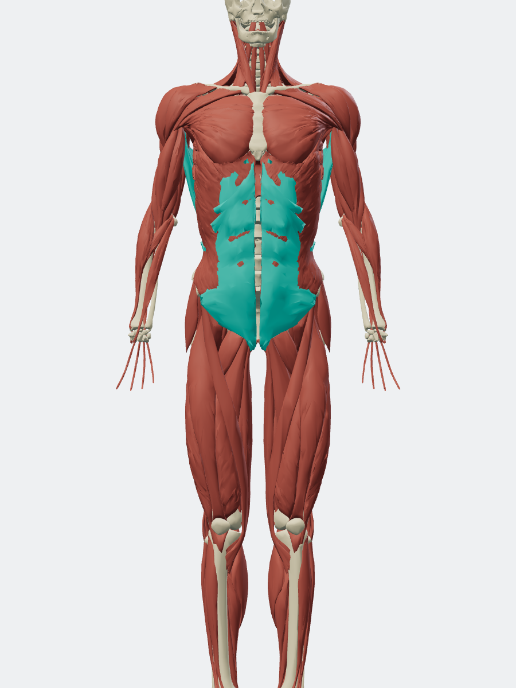
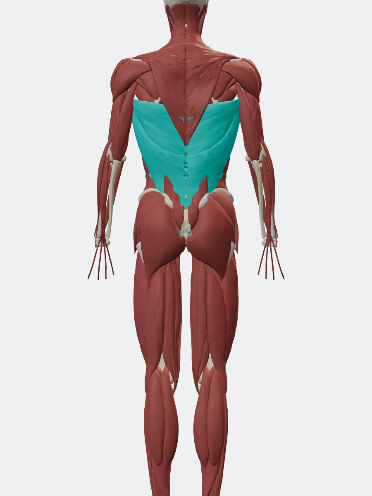
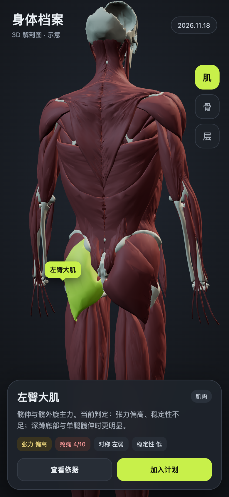

# Human Atlas 3D 解剖图可行性调研

> 调研日期：2026-11-18
> 结论：**技术可行，建议进入 1–2 周真机 spike，不建议直接排期实现。**
> 关联文档：`docs/anatomy-3d-direction.md`、`docs/research/human-atlas-site-map.csv`
>
> **后续更新（2026-11-18）**：Z-Anatomy 专项调研已完成，结论改为「Z-Anatomy 单源 + 每对象 1,500 面上限」更优（79/79 肌肉、431k 渲染面、Draco 1.70 MB）。本文的 Human Atlas 数据仍然有效，但「Human Atlas 为主 + Z-Anatomy 补 6 块」不再是首选。见 [z-anatomy-feasibility.md](z-anatomy-feasibility.md)。

## 0. 一句话结论

Human Atlas 能把我们词表里的 **79 块肌肉和 30 个有网格的骨骼部位**（另 10 个用标记点）做成一个约 **12 MB GLB（gzip 6.65 MB）**、**47.6 万三角面**的离线模型。它直接覆盖 73/79 块肌肉；缺的 6 块正好是躯干核心与背阔肌，但 Z-Anatomy 的对应网格与 BodyParts3D **同坐标系**，补齐只多 2.3 万三角面。真正的难点不是渲染，而是三件事：

1. **许可**：Human Atlas 是 CC BY 4.0，Z-Anatomy 是 CC BY-SA 4.0，混用后导出模型必须按 CC BY-SA 4.0 共享。
2. **Android 本地资源**：NSH 的 WebView `url_scheme` 只在 iOS/macOS/Linux 生效，Android 要另起一个只绑 `127.0.0.1` 的 HTTP 服务。
3. **产品价值**：3D 只有做出 2D 做不到的事——旋转、遮挡、逐层剥离——才值得它的资产与渲染成本。建议先验证这个交互，而不是先做全量集成。

---

## 1. 问题与成功标准

### 1.1 要回答的问题

- 能否在 App 内加载一套人体肌肉与骨骼 3D 模型？
- 能否把档案里的 Finding 精确标到单块肌肉，而不是只标肌群？
- 有没有可商用的开源模型？
- 在 NSH/Android 上有没有高性能、离线、可维护的嵌入方案？

### 1.2 范围

- **只覆盖词表**：79 块肌肉 + 40 个骨骼部位（其中 6 个是可记录的集合区域：颈/胸/腰椎、肋骨、腕骨、跖骨）。见 `.scratch/body-profile/anatomy-sites.md` 与 `src/anatomy/sites.rs`。
- **肌群不是几何单位**：23 个肌群是查询时聚合出来的视图，3D 里用成员肌肉的并集着色即可，不需要额外网格。这一点反而降低了展示复杂度。
- **不做全量解剖图谱**：不加载 2,234 个 Human Atlas 部件，只取词表子集。
- **不做诊断级精度**：3D 是示意，不是影像、手术规划或医学诊断。

### 1.3 成功标准

- 用户能在 15 秒内找到 agent 提到的具体肌肉，并分清左右。
- 能旋转到背面看臀肌、竖脊肌、背阔肌；能剥离/隐藏浅层，看到多裂肌、腰方肌、腹横肌。
- 中端真机稳定 30 fps 以上，首屏 2 秒内出现可交互模型。
- 资产增量不超过 10 MB APK，运行内存增量不超过 150 MB。
- 6 块补缺肌肉通过临床/视觉复核，接缝与比例不露馅。

---

## 2. 数据源：Human Atlas / BodyParts3D

### 2.1 它是什么

[Human Atlas](https://github.com/ashemag/human-atlas) 是一个开源 3D 解剖浏览器，数据来自 **BodyParts3D 4.0**。README 明确写了：

- 2,234 个可单独选中的网格，15 个解剖系统，3,432 个命名概念。
- 打包模型 2,288,268 个三角面，压缩后约 33 MB。
- 源几何 6,681,030 三角面；Human Atlas 用 meshoptimizer 简化到 2,288,268，最大相对误差 0.2%，并保留全部 2,234 个源网格。
- 数据是 **成年男性参考解剖**，不覆盖所有结构与变异。
- 代码 MIT，数据 CC BY 4.0。

实测 `atlas.json` 的系统分布：

| 系统 | 部件数 | 三角面 |
|---|---:|---:|
| muscular | 402 | 656,120 |
| skeletal | 296 | 338,056 |
| arterial | 639 | 333,798 |
| venous | 404 | 303,350 |
| nervous | 139 | 201,226 |
| sensory | 45 | 109,348 |
| digestive | 97 | 88,382 |
| respiratory | 119 | 82,078 |
| integumentary | 5 | 60,362 |
| cardiac | 23 | 50,988 |
| connective | 40 | 45,524 |
| endocrine | 4 | 4,756 |
| reproductive | 12 | 6,386 |
| urinary | 6 | 5,100 |
| lymphatic | 3 | 2,794 |
| **合计** | **2,234** | **2,288,268** |

### 2.2 坐标、单位与左右

- 单位是**米**：我们提取的子集包围盒约 `y = 0.005–1.708`，身高约 1.70 m；Human Atlas 全量含头发会到约 1.73 m。
- `y` 向上，`z` 向前（腹侧）；`x+` 是模型的**解剖左侧**（观者面向模型时的右侧）。实测负数 `x` 对应解剖右侧，正数 `x` 对应解剖左侧；例如 `Right external oblique` 的 `x` 为负，`Left external oblique` 的 `x` 为正。
- 左右是分开的网格；中线结构（膈肌、胸骨、骶骨）是单网格。
- 这对我们很关键：Finding 本来就分左右，3D 可以直接按 side 着色，不需要在运行时切网格。

### 2.3 几何格式与查看器做法

Human Atlas 不是 one-file-per-part，而是 15 个二进制 chunk。每个部件在 `atlas.json` 里记录：

- `chunk`、`positions`、`normals`、`indices` 的字节偏移；
- `vertexCount`、`indexCount`；
- `bounds`、`system`、`conceptId`。

二进制格式是：位置 `Float32`、法线 `Int16`（normalized）、索引 `Uint32`。查看器 `app/scene.tsx` 的做法值得直接抄：

- 按系统把几何**合批**，减少 draw call；
- 每个顶点带一个 `partIndex`，用一张 `DataTexture` 存每个部件的位移与可见性；
- 选中状态用另一张纹理，在 fragment shader 里混色；
- 拾取不用合批网格，而是保留每个部件的 component geometry 做 raycast；
- 移动端把 DPR 限制在 1.5。

这套“合批渲染 + 纹理状态 + 组件拾取”的结构，正好适合我们 200 个左右的 site/side 组，不需要为每块肌肉开一套材质。

### 2.4 许可

- BodyParts3D 4.0：**CC BY 4.0**，署名即可，没有 share-alike。
- Human Atlas 代码：**MIT**。
- Human Atlas 数据：**CC BY 4.0**。

如果只用 Human Atlas，许可很干净：在 App 的关于/法律页写清 BodyParts3D 与 Human Atlas 的署名即可。

### 2.5 其他候选

| 来源 | 覆盖 | 许可 | 几何/体积 | 结论 |
|---|---|---|---|---|
| **Human Atlas** | 73/79 肌肉、30/40 骨骼部位 | CC BY 4.0 | 2,234 部件、2.29M 三角面、gzip 33 MB | **主模型**：命名与细节最好 |
| **Z-Anatomy** | 79/79 肌肉、31/40 骨骼 + 9 定位点 | CC BY-SA 4.0 | Blender 模板 306 MB；子集简化后 431k 面 / Draco 1.70 MB | 见 [专项调研](z-anatomy-feasibility.md)：改为**主数据源** |
| **hpfrei body.glb** | 约 75/79 肌肉（按名称） | CC BY-SA 4.0 | 826 网格、8.25 MB、Z-Anatomy 简化版 | 可做补缺/原型；缺 TFL、拇展肌、趾短屈肌、头半棘肌，网格更粗 |
| **MyoSuite fullbody_atlas** | 416 块肌肉表面，无骨骼 | Apache-2.0 代码 + BodyParts3D 数据 | 轻量 GLB 约 9.9 MB | 不适合“肌肉 + 骨骼”视图 |

结论：**没有一个现成模型同时满足“79 块肌肉 + 40 个骨骼部位 + 单块可选中 + 许可干净 + 体积可控”**。后续 Z-Anatomy 专项调研把结论修正为：Z-Anatomy 单源在覆盖和体积上都更优，但许可变成 CC BY-SA 4.0；如果必须保持 CC BY 4.0，才回到 Human Atlas + 自制 6 块低模。

---

## 3. 覆盖度：79 块肌肉 + 40 个骨骼部位

### 3.1 方法

把 `atlas.json` 的 2,234 个部件按名称匹配到词表：

- 去掉 `Left` / `Right` 前缀，但保留侧别；
- 处理 `Lateral head of …`、`Long head of …`、`Clavicular part of …` 这类头/部件前缀；
- **跨系统搜索**：Human Atlas 有肌肉被归到 `skeletal` 或 `connective`，不能只查 `muscular`；
- 同一 `conceptId` 且同一包围盒的重复网格去重（例如舌骨重复了一次）；
- 每个 site 按左右合并成一个 group；集合区域（颈/胸/腰椎、肋骨、腕骨、跖骨）合并子网格。

完整的逐条映射、部件 ID、三角面数见 [human-atlas-site-map.csv](human-atlas-site-map.csv)。

### 3.2 汇总

| 类别 | Human Atlas 直接/聚合 | 需要补缺 | 父级/标记点 | 合计 |
|---|---:|---:|---:|---:|
| 肌肉 | 73 | 6 | 0 | 79 |
| 骨骼 | 30 | 0 | 10 | 40 |
| **合计** | **103** | **6** | **10** | **119** |

Human Atlas 直接映射的肌肉子集实测：

- 73 块肌肉，180 个部件；
- 256,310 顶点，278,708 三角面；
- GLB 7.72 MB，gzip 4.21 MB。

肌肉 + 骨骼（不含补缺）：

- 296 个部件，357,631 顶点，450,938 三角面；
- GLB 11.48 MB，gzip 6.39 MB。

### 3.3 六个缺失的躯干肌

这几块不是边角料，而是产品最常讨论的区域：

| 肌肉 | 为什么重要 | Z-Anatomy 补缺三角面（左右合计） |
|---|---|---:|
| 腹直肌 rectus abdominis | 躯干屈曲、抗伸展；核心判定高频 | 4,120 |
| 腹内斜肌 internal oblique | 旋转、侧屈、抗旋转 | 5,770 |
| 腹横肌 transversus abdominis | 深层核心稳定；`core-cylinder` 成员 | 6,864 |
| 腰方肌 quadratus lumborum | 侧向稳定、骨盆上提；下背痛高频 | 564 |
| 多裂肌 multifidus | 节段性脊柱稳定；下背痛高频 | 1,620 |
| 背阔肌 latissimus dorsi | 肩伸/肩内收；拉类动作主力 | 4,316 |
| **合计** | | **23,254** |

Z-Anatomy 的这 6 块网格与 BodyParts3D **同坐标系**，不是“看起来差不多”，而是可以直接叠：

- 例如 Z-Anatomy 的腹直肌包围盒 `y = 0.850–1.258`、`x = ±0.082`、`z = 0.045–0.120`；
- Human Atlas 的腹外斜肌包围盒 `y = 0.872–1.290`、`x = ±0.141`、`z = −0.063–0.119`；
- 两者的比例、原点、前后方向一致，补缺不需要做整体对齐，只需要在 Blender 里做一次视觉复核。

补缺后完整模型：

- **79 块肌肉 + 30 个有网格的骨骼部位**（另 10 个用标记点）；
- **372,857 顶点，476,300 三角面**；
- **GLB 12.05 MB，gzip 6.65 MB**；
- 207 个 site/side 组。

### 3.4 十个缺失的骨骼部位

| 部位 | Human Atlas 现状 | 建议表示 |
|---|---|---|
| 尾骨 coccyx | 没有独立网格 | 用骶骨下端做标记点；或自制几百面的低模 |
| 肩峰 acromion | 无独立网格，属于肩胛骨 | 肩胛骨淡色 + 肩峰标记点 |
| 喙突 coracoid process | 无独立网格 | 肩胛骨淡色 + 标记点 |
| 关节盂 glenoid cavity | 无独立网格 | 肩胛骨淡色 + 标记点 |
| 髂骨 ilium | 无独立网格，髋骨是一整块 | 髋骨淡色 + 区域标记；或 Blender 手工拆分 |
| 坐骨 ischium | 同上 | 同上 |
| 耻骨 pubis | 同上 | 同上 |
| 髂前上棘 ASIS | 无独立网格 | 标记点 |
| 髂后上棘 PSIS | 无独立网格 | 标记点 |
| 大转子 greater trochanter | 无独立网格，属于股骨 | 股骨淡色 + 标记点 |

这 10 个部位不建议为了“每个都有独立网格”去硬拆。它们是**骨性标志/子区域**，用“父骨淡色 + 标记点”比把整块肩胛骨或髋骨染成问题色更准确，也更便宜。如果产品一定要区域面片，髂骨/坐骨/耻骨可以在 Blender 里按解剖边界拆一次；ASIS/PSIS 这类点状标志仍然应该用标记。

标记点坐标可以在 Blender 里人工放，或从 Z-Anatomy 原始网格取顶点；按经验 10 个点约 1 天工作量（估算，未计入 3D 艺术家排期）。

### 3.5 其他坑

**系统误分类。** 下面这些在 Human Atlas 里不在 `muscular` 系统，只查肌肉系统会漏：

- `tibialis anterior`、`tibialis posterior`
- `fibularis longus`、`fibularis brevis`
- `levator scapulae`
- `subscapularis`
- `tensor fasciae latae`（在 `connective`）

**右侧颈长肌缺失。** Human Atlas 只有左侧 3 个部件（2,108 三角面），没有右侧。颈长肌是成对且基本对称的，建议把左侧镜像到右侧（翻转 `x` 与法线 `x`，并反转三角形绕序），补 2,108 三角面。Z-Anatomy 也有两侧，但网格更粗；镜像 Human Atlas 能保持细节一致。

**集合区域的父子重叠。** `cervical-vertebrae` 聚合了 C1–C7，而 `atlas`/`axis` 又是独立 site；当前映射会让 C1/C2 的几何同时出现在父级和子级，多 3,542 三角面，同时显示会 z-fighting。实现时二选一：

- 父级只映射 C3–C7，C1/C2 由子 site 补上，父级高亮时做成员并集；
- 保留完整 C1–C7 父级网格，子 site 的网格默认隐藏，只在选中 `atlas`/`axis` 时显示。

这是渲染层的可见性规则，不改变 `cervical-vertebrae` 作为可记录集合区域的领域含义。

### 3.6 渲染验证

下面是实际提取的模型渲染（不是 Human Atlas 官网截图）：

- 正面：青色是 Z-Anatomy 补缺的腹壁肌，红色是 Human Atlas 肌肉，米色是骨骼。
- 背面：青色是背阔肌；多裂肌、腰方肌在更深层，需要剥离/隔离才看得到。

从渲染看，比例与坐标系对齐成立；补缺网格的轮廓能接上 Human Atlas 的躯干。视觉上需要处理的不是“接不上”，而是：

- 补缺网格比 Human Atlas 的肌肉低模，转折更硬；
- 颅骨与手部肌腱裸露，产品化时需要弱化（见 §6.4）。

用同一份实际提取的模型做的手机端示意（左臀大肌高亮，非最终 UI）：

---

## 4. 性能与包体

### 4.1 实测资产

| 资产 | 顶点 | 三角面 | GLB | gzip |
|---|---:|---:|---:|---:|
| Human Atlas 肌肉子集 | 256,310 | 278,708 | 7.72 MB | 4.21 MB |
| Human Atlas 肌肉 + 骨骼 | 357,631 | 450,938 | 11.48 MB | 6.39 MB |
| 补缺后完整模型 | 372,857 | 476,300 | 12.05 MB | 6.65 MB |

476,300 里包含 C1/C2 在颈椎父级与寰椎/枢椎子级各一份的 3,542 三角面；按 §3.5 的可见性规则去掉重复后约 472,758。

这个体积比 Human Atlas 全量 33 MB 小很多，因为我们只取词表里的 119 个 site，而不是 2,234 个部件。**不需要一开始就上 Draco**：6.65 MB 的 gzip 资产在本地加载已经很快，Draco 还会多一个 1 MB 左右的 wasm 解码器和 100–300 ms 解码时间。

### 4.2 渲染预算

在本机 headless Edge（桌面 GPU）里加载完整模型：

- 207 个 mesh，199 个实际 draw call（有视锥剔除）；
- 可见 464,888 三角面；
- 垂直同步下 60.8 fps。

这个数字只能证明“桌面浏览器没问题”，**不能代表手机**。Android 模拟器用 SwiftShader，帧率没有参考价值。真机需要测三件事：

1. 连续旋转 30 秒的平均/最低帧率与发热；
2. 首屏从点开到可交互的时间；
3. WebView 进程 + GLB 解码 + GPU 缓冲的增量内存。

按资产规模估算，中端 Android 真机应该落在 **30–60 fps、100–150 MB 增量内存、0.5–2 s 首屏**。这是估算，不是承诺；spike 必须实测。

### 4.3 优化手段

按收益排序：

1. **按材质合并**：把 207 个 site/side 组合并成 2–4 个 draw call（肌肉、骨骼、补缺、皮肤），用每顶点 `siteIndex` + 小纹理存状态，像 Human Atlas 那样。拾取保留组件几何或 BVH。
2. **简单材质**：`MeshLambertMaterial` / 自定义 matcap 足够，别用 `MeshStandardMaterial` + 环境贴图。解剖图要的是体积感，不是 PBR。
3. **DPR 上限 1.5**：手机上 2x/3x DPR 的填充率代价远大于几何代价。
4. **uint16 索引**：每个 site/side 组都小于 65k 顶点，索引可以从 4 字节降到 2 字节，索引数据减半。
5. **位置量化**：`KHR_mesh_quantization` 把位置压到 int16。模型高 1.7 m，int16 精度约 0.03 mm，远高于屏幕需要；顶点数据从 12 字节降到 6 字节。
6. **视锥剔除 + 冻结矩阵**：静态解剖模型不需要每帧更新矩阵；`matrixAutoUpdate = false`。
7. **按需加载补缺/骨骼**：如果首屏只看肌肉，可以把骨骼与皮肤拆成第二个 GLB，点“骨骼”再加载。

量化 + uint16 后，11.5 MB 的肌肉+骨骼大约能到 7 MB 未压缩、3.5–4 MB gzip；如果再加 meshopt，2–3 MB 是合理目标。但这是优化项，不是 spike 的前置条件。

---

## 5. NSH / Android 嵌入

### 5.1 NSH 没有原生 3D 网格管线

NSH 的 `Canvas` 是 2D；`Shader` 是对一个盒子做 WGSL fragment shader，没有顶点缓冲、深度缓冲、网格管线。想在 NSH 里做真 3D，只有两条路：

1. WebView + Three.js / WebGL；
2. 换 Gradle 宿主，用 `GLSurfaceView` / OpenGL ES 写原生组件。

### 5.2 WebView + Three.js

这是成本最低、跨平台最稳的方案：

- Android System WebView 是 Chromium，现代设备通常支持 WebGL 2.0（最终以目标机型的 WebView 版本为准，spike 要显式检测 `WebGL2RenderingContext`）；
- Three.js 的 GLTFLoader 直接吃我们的 GLB；
- 交互（OrbitControls、raycast、材质换色）都是现成的；
- 同一套页面以后可以给 iOS/macOS 用。

代价是 WebView 的启动与内存开销，以及本地资源加载的坑（下一节）。

### 5.3 Android 本地资源：`url_scheme` 不支持，loopback server 可行

NSH 的 WebView 文档写得很清楚：`url_scheme` 由 **iOS、macOS 和 Linux** 提供（WebKit 的 `WKURLSchemeHandler` / `webkit_web_context_register_uri_scheme`）；**Android 不在列表里**。所以不能像桌面那样用 `app-asset://` 直接喂 GLB。

可行的 Android 方案是 **Rust 起一个只绑 `127.0.0.1` 的临时 HTTP 服务**：

- `TcpListener::bind("127.0.0.1:0")` 让系统分配端口；
- App 已有网络权限（LLM 直连需要 `INTERNET`），loopback 监听不需要额外权限；
- 只服务 `/`、`/app.js`、`/model.glb` 三个固定路径；
- `/model.glb` 直接返回 gzip 字节并带 `Content-Encoding: gzip`，让 WebView 的网络栈解压，不依赖 JS 的 `DecompressionStream`（老 WebView 可能没有）；
- WebView 加载 `http://127.0.0.1:<port>/`；
- `nsh.json` 里 `capabilities.webview.hosts` 加 `127.0.0.1`（host 匹配忽略端口）；
- Android 需要 `android.usesCleartextTraffic: true`（或更窄的 network security config，但 NSH 目前只暴露这个开关）；
- 页面关闭时停掉 listener，端口不长期占用。

这个方案的优点是：离线、无 CORS、所有平台同一套页面、APK 里只多一个 gzip 资产。缺点是：多一个本地服务生命周期、需要 cleartext 开关、需要确保只绑 loopback 且路径白名单。

spike 的第一步就是验证 `127.0.0.1` 能被 `webview.hosts` 放行；如果 IP 形式的 host 不被接受，就用 `localhost`，并在真机上确认 cleartext 策略。

其他方案为什么不选：

| 方案 | 问题 |
|---|---|
| `url_scheme` | Android 不支持 |
| 内联 base64 | 12 MB 变 16 MB 字符串，WebView 内存与解析都难受 |
| `file:///android_asset` | NSH 的 WebView 没有暴露 asset loader；`file://` 下的 fetch/CORS 不可靠，未验证 |
| 远程 CDN | 首次加载依赖网络，隐私与离线都不合适 |
| 原生 GL | 性能最好，但要换 Gradle 宿主，见下 |

### 5.4 原生 GL 方案

如果 WebView 真机性能不达标，原生 `GLSurfaceView` 是终极方案：

- Android 端由 Java/Kotlin 宿主通过 `NshView.registerComponent` 注册；
- `#[native_components]` 宏只支持 windows/macos/linux/ios，**不支持 Android**；
- 当前 `nsh package` 是**无 Gradle** 打包；引入原生 GL 等于换成 Gradle 宿主，构建、签名、发布、热更新都要改。

这是一个**单向门**。在 3D 的产品价值没验证前，不建议走。

### 5.5 方案对比

| 方案 | 3D | 真机性能 | 离线 | 构建改动 | 建议 |
|---|---|---|---|---|---|
| WebView + Three.js + loopback | 是 | 中上，需实测 | 是 | 小 | **spike 首选** |
| Gradle 宿主 + `GLSurfaceView` | 是 | 最好 | 是 | 大，单向门 | WebView 不达标再做 |
| NSH Canvas/Shader | 否 | 最好 | 是 | 无 | 做不了真 3D |
| 2D SVG/Canvas | 否 | 最好 | 是 | 无 | 已被否决，保留为降级 |

---

## 6. 产品与临床风险

### 6.1 缺的 6 块正好是核心区

如果只用 Human Atlas，3D 图会在腹壁、下背、背阔肌这些最常被讨论的区域“缺一块”。这不是可以靠文案绕过的：用户看到腹部是空的，会直接不信任模型。补缺是**必须项**，不是 nice-to-have。

### 6.2 成年男性参考模型

BodyParts3D 是成年男性参考解剖。它不等于用户本人：

- 女性、不同体型、不同年龄的用户可能觉得“这不是我的身体”；
- 肌肉体积、脂肪分布、骨盆形态都有差异；
- 3D 越逼真，用户越容易把它当成个体化影像。

产品上要明确写“参考解剖示意”，不要用“你的肌肉就是这样”这类文案。

### 6.3 3D 暗示精度

2D 色块天然是示意的；3D 模型会被用户当成“精确结构”。但：

- Human Atlas 是简化过的（0.2% 相对误差），不是影像分割；
- 补缺网格是低模；
- 骨性标志是标记点，不是独立骨面；
- 肌肉边界在活体上本来就有变异。

所以 3D 图必须定位为“定位与沟通工具”，不是诊断工具。Finding 的置信度、证据与“不确定”仍然要在卡片里讲清楚。

### 6.4 视觉问题

实际渲染暴露了三个产品化问题：

1. **颅骨与面部**：没有面肌，正面看是骷髅。可以默认把镜头聚在颈以下，或加一层 5–10% 不透明度的皮肤壳（Human Atlas 的 `Skin` 网格 44,744 三角面）。
2. **手部肌腱**：我们只取了词表肌肉，手指上的肌腱像细线。可以裁掉手部，或加简单的手部表面。
3. **补缺网格的低模感**：Z-Anatomy 的腹壁/背阔肌比 Human Atlas 粗，转角更硬。统一材质、平滑着色、适当的细分/重拓扑可以缓解；spike 要做视觉复核。

### 6.5 交互复杂度

3D 不是“能转”就够了。真正有用的是：

- 正面/背面/侧面一键切换；
- 左/右分色；
- 点击拾取到单块肌肉；
- 隔离选中肌肉；
- **剥离浅层**：把胸大肌、腹外斜肌、背阔肌淡出，露出腹横肌、多裂肌、腰方肌。

最后一条是 3D 相对 2D 的核心价值，也是 spike 最该验证的交互。如果用户只用旋转、不看深层，那 3D 的性价比会很低。

---

## 7. 推荐的 spike

### 7.1 范围（1–2 周）

1. **资产**：用 Human Atlas 的 73 块肌肉 + 30 个有网格的骨骼部位，加 Z-Anatomy 的 6 块躯干肌，镜像右侧颈长肌；导出 12 MB GLB。
2. **查看器**：WebView + Three.js；正面/背面/侧面；左/右分色；点击拾取；隔离；浅层淡出。
3. **状态**：三种即可——正常、Finding（问题色）、选中（高亮 + 卡片）。
4. **Android 资源**：Rust loopback HTTP 服务 + gzip GLB + `usesCleartextTraffic`；全程离线。
5. **真机**：至少一台中端 Android 真机（不是模拟器），测帧率、首屏、内存、发热。
6. **复核**：6 块补缺肌肉 + 10 个骨性标记点，找懂解剖的人看一遍比例、起点/止点、左右。

### 7.2 验收门槛

- 连续旋转 30 秒：平均 ≥ 30 fps，最低 ≥ 25 fps，不因发热掉到 20 fps 以下。
- 首屏 < 2 s；点肌肉到高亮 < 100 ms。
- 增量内存 < 150 MB；APK 增量 < 10 MB。
- 6 块补缺网格在正常材质下没有明显接缝/穿模；临床复核通过。
- 5 个用户里至少 4 个能在 15 秒内找到指定肌肉并说对左右。

### 7.3 不做什么

- 不做全量 2,234 部件；
- 不做皮肤/毛发/内脏/血管；
- 不做诊断级精度；
- 不做 iOS；
- 不换 Gradle 宿主；
- 不为 3D 改领域模型：`site_id -> mesh_id` 是展示映射，不是新的 Finding 粒度。

---

## 8. 决策建议

### 8.1 如果 spike 通过

- 用 WebView 方案，放在档案页的“身体图”入口，3D 作为主视图，2D 保留为降级/快速浏览；
- 资产按材质合并、uint16 索引、位置量化，把包体压到 3–4 MB gzip；
- 把 3D 资产、映射表、生成脚本纳入仓库，保证可复现；
- 在关于页写清 BodyParts3D / Human Atlas / Z-Anatomy 的署名与许可。

### 8.2 如果 spike 失败

按失败原因分：

- **帧率/内存不达标**：先做合批、量化、降 DPR；仍不行再评估 Gradle + 原生 GL。
- **补缺网格视觉不可接受**：改用 Z-Anatomy 原始 Blender 网格重新简化，或自制 6 块低模。
- **用户不用 3D**：停止 3D，回到 2D，把资源投到档案时间线与计划解释。
- **许可不接受**：自制 6 块低模，保留 Human Atlas 的 CC BY 4.0；或只用 Human Atlas 的 73 块，缺的 6 块用 2D 卡片补。

### 8.3 许可决策

这是本调研里唯一需要业务/法务拍板的事：

- **方案 A（推荐先做）**：Human Atlas + Z-Anatomy 6 块，导出模型按 **CC BY-SA 4.0** 共享。App 代码可以闭源，但 3D 资产及其修改要按 share-alike 提供。需要法务确认“在 App 内分发 + 公开资产下载链接”是否满足。
- **方案 B（许可最干净）**：Human Atlas 73 块 + 自制 6 块低模，整体保持 **CC BY 4.0**。多 2–5 天建模 + 临床复核，但不引入 share-alike。

如果产品对“模型资产必须闭源”有硬要求，选 B；否则 A 的时间成本更低。

---

## 附录 A：79 块肌肉映射

“网格 L/R/M”是左侧/右侧/中线部件数；“三角面”是补缺后的最终值。完整部件 ID 见 [human-atlas-site-map.csv](human-atlas-site-map.csv)。

| 部位 | id | 状态 | 网格 L/R/M | 三角面 | 说明 |
|---|---|---|---:|---:|---|
| 腓肠肌 | `gastrocnemius` | 多头/多部件合并 | 2/2/0 | 3,260 | 按左右合并头/部件 |
| 比目鱼肌 | `soleus` | 直接 | 1/1/0 | 1,980 |  |
| 跖肌 | `plantaris` | 直接 | 1/1/0 | 1,104 |  |
| 胫骨前肌 | `tibialis-anterior` | 直接（系统误分类） | 1/1/0 | 1,522 | 在 skeletal/connective 中命名，需跨系统匹配 |
| 胫骨后肌 | `tibialis-posterior` | 直接（系统误分类） | 1/1/0 | 3,878 | 在 skeletal/connective 中命名，需跨系统匹配 |
| 腓骨长肌 | `fibularis-longus` | 直接（系统误分类） | 1/1/0 | 1,782 | 在 skeletal/connective 中命名，需跨系统匹配 |
| 腓骨短肌 | `fibularis-brevis` | 直接（系统误分类） | 1/1/0 | 1,256 | 在 skeletal/connective 中命名，需跨系统匹配 |
| 拇长屈肌 | `flexor-hallucis-longus` | 直接 | 1/1/0 | 1,324 |  |
| 趾长屈肌 | `flexor-digitorum-longus` | 直接 | 1/1/0 | 2,030 |  |
| 趾长伸肌 | `extensor-digitorum-longus` | 直接 | 1/1/0 | 2,652 |  |
| 拇长伸肌 | `extensor-hallucis-longus` | 直接 | 1/1/0 | 1,074 |  |
| 腘肌 | `popliteus` | 直接 | 1/1/0 | 930 |  |
| 拇展肌 | `abductor-hallucis` | 直接 | 1/1/0 | 1,106 |  |
| 趾短屈肌 | `flexor-digitorum-brevis` | 直接 | 1/1/0 | 2,526 |  |
| 股直肌 | `rectus-femoris` | 直接 | 1/1/0 | 2,500 |  |
| 股外侧肌 | `vastus-lateralis` | 直接 | 1/1/0 | 2,940 |  |
| 股内侧肌 | `vastus-medialis` | 直接 | 1/1/0 | 2,000 |  |
| 股中间肌 | `vastus-intermedius` | 直接 | 1/1/0 | 1,872 |  |
| 股二头肌 | `biceps-femoris` | 多头/多部件合并 | 2/2/0 | 3,220 | 按左右合并头/部件 |
| 半腱肌 | `semitendinosus` | 直接 | 1/1/0 | 1,192 |  |
| 半膜肌 | `semimembranosus` | 直接 | 1/1/0 | 2,028 |  |
| 长收肌 | `adductor-longus` | 直接 | 1/1/0 | 1,148 |  |
| 短收肌 | `adductor-brevis` | 直接 | 1/1/0 | 1,050 |  |
| 大收肌 | `adductor-magnus` | 直接 | 1/1/0 | 3,306 |  |
| 股薄肌 | `gracilis` | 直接 | 1/1/0 | 1,392 |  |
| 耻骨肌 | `pectineus` | 直接 | 1/1/0 | 1,360 |  |
| 缝匠肌 | `sartorius` | 直接 | 1/1/0 | 1,512 |  |
| 阔筋膜张肌 | `tensor-fasciae-latae` | 直接（系统误分类） | 1/1/0 | 1,252 | 在 skeletal/connective 中命名，需跨系统匹配 |
| 臀大肌 | `gluteus-maximus` | 直接 | 1/1/0 | 2,476 |  |
| 臀中肌 | `gluteus-medius` | 直接 | 1/1/0 | 2,748 |  |
| 臀小肌 | `gluteus-minimus` | 直接 | 1/1/0 | 2,868 |  |
| 梨状肌 | `piriformis` | 直接 | 1/1/0 | 1,224 |  |
| 闭孔内肌 | `obturator-internus` | 直接 | 1/1/0 | 2,508 |  |
| 闭孔外肌 | `obturator-externus` | 直接 | 1/1/0 | 1,126 |  |
| 上孖肌 | `gemellus-superior` | 直接 | 1/1/0 | 612 |  |
| 下孖肌 | `gemellus-inferior` | 直接 | 1/1/0 | 916 |  |
| 股方肌 | `quadratus-femoris` | 直接 | 1/1/0 | 1,562 |  |
| 髂肌 | `iliacus` | 直接 | 1/1/0 | 2,656 |  |
| 腰大肌 | `psoas-major` | 直接 | 1/1/0 | 2,810 |  |
| 腹直肌 | `rectus-abdominis` | Z-Anatomy 补缺 | 1/1/0 | 4,120 | Z-Anatomy 网格；坐标与 BodyParts3D 对齐 |
| 腹外斜肌 | `external-oblique` | 直接 | 1/1/0 | 49,200 |  |
| 腹内斜肌 | `internal-oblique` | Z-Anatomy 补缺 | 1/1/0 | 5,770 | Z-Anatomy 网格；坐标与 BodyParts3D 对齐 |
| 腹横肌 | `transversus-abdominis` | Z-Anatomy 补缺 | 1/1/0 | 6,864 | Z-Anatomy 网格；坐标与 BodyParts3D 对齐 |
| 腰方肌 | `quadratus-lumborum` | Z-Anatomy 补缺 | 1/1/0 | 564 | Z-Anatomy 网格；坐标与 BodyParts3D 对齐 |
| 髂肋肌 | `iliocostalis` | 多头/多部件合并 | 3/3/0 | 12,468 | 按左右合并头/部件 |
| 最长肌 | `longissimus` | 多头/多部件合并 | 3/3/0 | 11,712 | 按左右合并头/部件 |
| 棘肌 | `spinalis` | 多头/多部件合并 | 2/2/0 | 4,616 | 两个无侧名的 `spinalis` 按包围盒分到左右，再合并 |
| 多裂肌 | `multifidus` | Z-Anatomy 补缺 | 1/1/0 | 1,620 | Z-Anatomy 网格；坐标与 BodyParts3D 对齐 |
| 膈肌 | `diaphragm` | 直接 | 0/0/1 | 15,074 |  |
| 背阔肌 | `latissimus-dorsi` | Z-Anatomy 补缺 | 1/1/0 | 4,316 | Z-Anatomy 网格；坐标与 BodyParts3D 对齐 |
| 前锯肌 | `serratus-anterior` | 直接 | 1/1/0 | 21,652 |  |
| 斜方肌 | `trapezius` | 多头/多部件合并 | 3/3/0 | 14,456 | 按左右合并头/部件 |
| 大菱形肌 | `rhomboid-major` | 直接 | 1/1/0 | 3,712 |  |
| 小菱形肌 | `rhomboid-minor` | 直接 | 1/1/0 | 1,488 |  |
| 肩胛提肌 | `levator-scapulae` | 直接（系统误分类） | 1/1/0 | 2,630 | 在 skeletal/connective 中命名，需跨系统匹配 |
| 胸大肌 | `pectoralis-major` | 多头/多部件合并 | 3/3/0 | 10,414 | 按左右合并头/部件 |
| 胸小肌 | `pectoralis-minor` | 直接 | 1/1/0 | 5,202 |  |
| 三角肌 | `deltoid` | 多头/多部件合并 | 3/3/0 | 6,432 | 按左右合并头/部件 |
| 冈上肌 | `supraspinatus` | 直接 | 1/1/0 | 1,128 |  |
| 冈下肌 | `infraspinatus` | 直接 | 1/1/0 | 1,066 |  |
| 小圆肌 | `teres-minor` | 直接 | 1/1/0 | 736 |  |
| 大圆肌 | `teres-major` | 直接 | 1/1/0 | 1,402 |  |
| 肩胛下肌 | `subscapularis` | 直接（系统误分类） | 1/1/0 | 3,036 | 在 skeletal/connective 中命名，需跨系统匹配 |
| 肱二头肌 | `biceps-brachii` | 多头/多部件合并 | 2/2/0 | 2,604 | 按左右合并头/部件 |
| 肱肌 | `brachialis` | 直接 | 1/1/0 | 1,414 |  |
| 肱桡肌 | `brachioradialis` | 直接 | 1/1/0 | 2,142 |  |
| 肱三头肌 | `triceps-brachii` | 多头/多部件合并 | 3/3/0 | 3,536 | 按左右合并头/部件 |
| 旋前圆肌 | `pronator-teres` | 多头/多部件合并 | 2/2/0 | 2,806 | 按左右合并头/部件 |
| 旋后肌 | `supinator` | 直接 | 1/1/0 | 2,548 |  |
| 桡侧腕屈肌 | `flexor-carpi-radialis` | 直接 | 1/1/0 | 622 |  |
| 桡侧腕长伸肌 | `extensor-carpi-radialis-longus` | 直接 | 1/1/0 | 1,088 |  |
| 指伸肌 | `extensor-digitorum` | 直接 | 1/1/0 | 2,116 |  |
| 胸锁乳突肌 | `sternocleidomastoid` | 直接 | 1/1/0 | 4,522 |  |
| 前斜角肌 | `scalenus-anterior` | 直接 | 1/1/0 | 1,576 |  |
| 中斜角肌 | `scalenus-medius` | 直接 | 1/1/0 | 2,598 |  |
| 颈长肌 | `longus-colli` | 直接 | 3/3/0 | 4,216 | Human Atlas 原始只有左侧 2,108；右侧由左侧镜像 2,108 |
| 头长肌 | `longus-capitis` | 直接 | 1/1/0 | 1,794 |  |
| 头夹肌 | `splenius-capitis` | 直接 | 1/1/0 | 3,432 |  |
| 头半棘肌 | `semispinalis-capitis` | 直接 | 1/1/0 | 2,676 |  |
| **小计** | | | | **304,070** | |

## 附录 B：40 个骨骼部位映射

| 部位 | id | 状态 | 网格 L/R/M | 三角面 | 说明 |
|---|---|---|---:|---:|---|
| 额骨 | `frontal-bone` | 直接 | 0/0/1 | 5,112 |  |
| 颞骨 | `temporal-bone` | 直接 | 1/1/0 | 5,734 |  |
| 枕骨 | `occipital-bone` | 直接 | 0/0/1 | 4,912 |  |
| 下颌骨 | `mandible` | 直接 | 0/0/1 | 2,348 |  |
| 上颌骨 | `maxilla` | 直接 | 1/1/0 | 7,258 |  |
| 颧骨 | `zygomatic-bone` | 直接 | 1/1/0 | 2,202 |  |
| 舌骨 | `hyoid-bone` | 直接 | 0/0/1 | 1,036 |  |
| 寰椎 | `atlas` | 直接 | 0/0/1 | 1,514 |  |
| 枢椎 | `axis` | 直接 | 0/0/1 | 2,028 |  |
| 颈椎 | `cervical-vertebrae` | 子网格聚合 | 0/0/7 | 12,752 | 合并子网格为一个可记录区域 |
| 胸椎 | `thoracic-vertebrae` | 子网格聚合 | 0/0/12 | 22,420 | 合并子网格为一个可记录区域 |
| 腰椎 | `lumbar-vertebrae` | 子网格聚合 | 0/0/5 | 12,620 | 合并子网格为一个可记录区域 |
| 骶骨 | `sacrum` | 直接 | 0/0/1 | 5,058 |  |
| 尾骨 | `coccyx` | 父级/标记点 | - | 0 | 无独立网格；用骶骨下端标记 |
| 胸骨 | `sternum` | 子网格聚合 | 0/0/3 | 5,566 | 合并子网格为一个可记录区域 |
| 肋骨 | `ribs` | 子网格聚合 | 12/12/0 | 38,380 | 合并子网格为一个可记录区域 |
| 锁骨 | `clavicle` | 直接 | 1/1/0 | 1,646 |  |
| 肩胛骨 | `scapula` | 直接 | 1/1/0 | 11,936 |  |
| 肩峰 | `acromion` | 父级/标记点 | - | 0 | 无独立网格；父骨 + 标记点 |
| 喙突 | `coracoid-process` | 父级/标记点 | - | 0 | 无独立网格；父骨 + 标记点 |
| 关节盂 | `glenoid-cavity` | 父级/标记点 | - | 0 | 无独立网格；父骨 + 标记点 |
| 肱骨 | `humerus` | 直接 | 1/1/0 | 2,032 |  |
| 桡骨 | `radius` | 直接 | 1/1/0 | 814 |  |
| 尺骨 | `ulna` | 直接 | 1/1/0 | 916 |  |
| 腕骨 | `carpal-bones` | 子网格聚合 | 8/8/0 | 5,354 | 合并子网格为一个可记录区域 |
| 髋骨 | `hip-bone` | 直接 | 1/1/0 | 3,706 |  |
| 髂骨 | `ilium` | 父级/标记点 | - | 0 | 无独立网格；父骨 + 标记点 |
| 坐骨 | `ischium` | 父级/标记点 | - | 0 | 无独立网格；父骨 + 标记点 |
| 耻骨 | `pubis` | 父级/标记点 | - | 0 | 无独立网格；父骨 + 标记点 |
| 髂前上棘 | `asis` | 父级/标记点 | - | 0 | 无独立网格；父骨 + 标记点 |
| 髂后上棘 | `psis` | 父级/标记点 | - | 0 | 无独立网格；父骨 + 标记点 |
| 股骨 | `femur` | 直接 | 1/1/0 | 1,814 |  |
| 大转子 | `greater-trochanter` | 父级/标记点 | - | 0 | 无独立网格；父骨 + 标记点 |
| 髌骨 | `patella` | 直接 | 1/1/0 | 608 |  |
| 胫骨 | `tibia` | 直接 | 1/1/0 | 1,254 |  |
| 腓骨 | `fibula` | 直接 | 1/1/0 | 576 |  |
| 距骨 | `talus` | 直接 | 1/1/0 | 2,328 |  |
| 跟骨 | `calcaneus` | 直接 | 1/1/0 | 2,198 |  |
| 足舟骨 | `navicular-bone` | 直接 | 1/1/0 | 1,242 |  |
| 跖骨 | `metatarsals` | 子网格聚合 | 5/5/0 | 6,866 | 合并子网格为一个可记录区域 |
| **小计** | | | | **172,230** | |

## 附录 C：数字是怎么来的

这不是引用别人的估算，而是对 Human Atlas 仓库里的实际二进制做的提取与测量。步骤：

1. 从 Human Atlas 仓库的 `public/models/` 取 15 个 `body-*.bin.gz`（约 33 MB）与 `atlas.json`。
2. 解压 chunk，按 `atlas.json` 的 `positions` / `normals` / `indices` 偏移读取每个部件。
3. 按 §3.1 的规则把部件映射到 119 个 site；同一 site 的左右/多头合并，集合区域合并子网格。
4. 用 `Float32` 位置、`Int16` 归一化法线、`Uint32` 索引写出 GLB；用 `zlib.gzipSync(level 9)` 测 gzip。
5. 从 `hpfrei/body-anatomy-3d-viewer` 的 `body.glb`（Z-Anatomy 派生，Draco）解出 6 块缺失肌肉；按包围盒确认左右与坐标。
6. 把左侧颈长肌镜像到右侧：`x -> -x`，法线 `x -> -nx`，反转三角形绕序。
7. 用 Three.js + headless Edge 渲染并测量 draw call / 三角面 / 桌面帧率。

本仓库只提交映射结果 [human-atlas-site-map.csv](human-atlas-site-map.csv) 与报告；GLB 本身没有入库（12 MB）。如果进入实现，应该把“下载 chunk → 映射 → 补缺 → 导出”的管线写成仓库脚本，保证可复现。

## 参考

### 数据与许可

- Human Atlas 仓库与 README：<https://github.com/ashemag/human-atlas>
- Human Atlas `atlas.json`：<https://github.com/ashemag/human-atlas/blob/main/public/models/atlas.json>
- Human Atlas 查看器 `app/scene.tsx`：<https://github.com/ashemag/human-atlas/blob/main/app/scene.tsx>
- Human Atlas 几何格式与加载：`app/anatomy.ts`、`app/model-download.ts`、`scripts/convert-anatomy.py`、`scripts/optimize-anatomy.mjs`、`scripts/compress-models.mjs`
- Human Atlas 署名：<https://github.com/ashemag/human-atlas/blob/main/public/ATTRIBUTION.md>
- BodyParts3D 4.0 下载：<https://dbarchive.biosciencedbc.jp/en/bodyparts3d/download.html>
- Z-Anatomy 仓库：<https://github.com/Z-Anatomy/Models-of-human-anatomy>
- Z-Anatomy 许可与署名：<https://github.com/Z-Anatomy/Models-of-human-anatomy/blob/master/License.txt>
- hpfrei `body-anatomy-3d-viewer`（Z-Anatomy 简化版，CC BY-SA 4.0）：<https://github.com/hpfrei/body-anatomy-3d-viewer>
- MyoSuite（备选，416 块肌肉表面，Apache-2.0 代码 + BodyParts3D 数据）：<https://github.com/myohub/myosuite>
- MyoSuite 数据署名：<https://github.com/myohub/myosuite/blob/main/myosuite/viz/assets/CREDITS.md>

### NSH / Android

- NSH WebView：<https://nsh.dev/docs/web-view-and-video.md>
  - `url_scheme` 平台支持：iOS、macOS、Linux；Android 不在列表。
  - `webview.hosts` 与本地页面：<https://nsh.dev/docs/sandbox-and-capabilities.md>
- NSH 原生组件：<https://nsh.dev/docs/native-components.md>
  - Android 由 Java/Kotlin 宿主 `NshView.registerComponent` 注册。
  - `#[native_components]` 支持 windows/macos/linux/ios。
- NSH Android：<https://nsh.dev/docs/android.md>
  - `nsh package` 无 Gradle 打包；`NshView` 嵌入；`usesCleartextTraffic`。
- NSH 打包：<https://nsh.dev/docs/packaging.md>
  - `android.usesCleartextTraffic` 示例。

### 本仓库

- 词表人工真源：`.scratch/body-profile/anatomy-sites.md`
- 词表类型与规则：`src/anatomy/mod.rs`
- 词表生成内容：`src/anatomy/sites.rs`
- Finding 粒度：`docs/adr/0003-append-only-findings-single-granularity.md`
- 五轴枚举：`docs/adr/0004-five-axis-enum.md`
