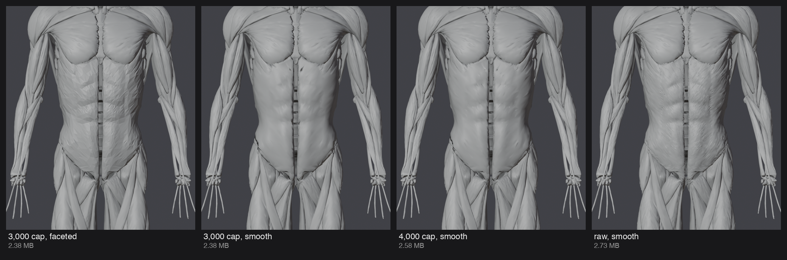

# Z-Anatomy 3D 数据源调研

> 调研日期：2026-11-18
> 结论：**Z-Anatomy 可以作为唯一主数据源，建议用它替代「Human Atlas + Z-Anatomy 补 6 块」的混合方案。**
> 关联文档：[anatomy-3d-direction.md](../anatomy-3d-direction.md)、[human-atlas-feasibility.md](human-atlas-feasibility.md)
> 逐条映射：[z-anatomy-site-map.csv](z-anatomy-site-map.csv)
> 骨性标志坐标：[z-anatomy-landmarks.csv](z-anatomy-landmarks.csv)
> 三方对比渲染：[z-anatomy-comparison.png](z-anatomy-comparison.png)

## 0. 一句话结论

Z-Anatomy 是 BodyParts3D 的一个 Blender 图谱衍生版，**79 块肌肉全部有网格**，**40 个骨骼部位里 31 个有网格、9 个有定位点**。它的原始资产很重（306 MB `.blend`、4,569 个网格、410 万三角面、1,944 个 collection），但把我们的 119 个 site 单独抽出来后：1,500 面上限是 **432,790 个渲染三角面、Draco GLB 1.70 MB**；清掉 custom split normals 并平滑后，原始几何是 **1,502,535 个渲染三角面、Draco GLB 2.73 MB**，3,000 面上限是 **743,912 面、2.38 MB**。后两者比现有 Human Atlas 混合模型（476,290 面、Draco 2.51 MB）覆盖更全，近景也更自然，而且不需要补 6 块肌肉、不需要镜像缺失的右侧颈长肌。

真正的代价不在体积，而在三件事：

1. **许可**：Z-Anatomy 是 CC BY-SA 4.0，上游 BodyParts3D 是 CC-BY-SA 2.1 Japan。模型资产必须 share-alike；App 代码可以闭源，但模型及修改要按 CC BY-SA 4.0 分发。
2. **命名**：Z-Anatomy 用 TA2 变体和「部位拆分」，同一块肌肉可能叫 `Spinalis capitis muscle`、`External abdominal oblique muscle`，或拆成 `Long head` / `Short head`。必须有显式别名表，不能靠子串匹配。
3. **工程化**：它是一个带 1,660 个文字标签、951 条引线、横断面辅助对象的 Blender 模板，不是导出即用的游戏资产。需要一条自己的 headless 导出管线。

如果产品能接受 CC BY-SA 4.0，**推荐 Z-Anatomy 单源**；如果模型资产必须保持 CC BY 4.0（不允许 share-alike），那 Z-Anatomy 在许可上直接出局，只能回到 Human Atlas + 自制 6 块低模。

---

## 1. 调研问题与判定标准

### 1.1 要回答的问题

- Z-Anatomy 到底是什么？和 Human Atlas、BodyParts3D 是什么关系？
- 它能否覆盖我们的 79 块肌肉 + 40 个骨骼部位？
- 它的网格质量、坐标系、左右、命名能不能直接用于「点名单块肌肉」？
- 原始资产多重？简化后能不能进手机？比 Human Atlas 方案更好还是更差？
- 许可能不能接受？有没有隐藏的 NC/GPL 污染？

### 1.2 判定标准

| 维度 | 要求 |
|---|---|
| 覆盖 | 79/79 肌肉；40/40 骨骼部位（至少 30 个有网格，其余可用标记点） |
| 选中粒度 | 单块肌肉一个 site，可左右分开；肌群是查询聚合，不是几何单位 |
| 资产 | 简化后 ≤ 500k 三角面；Draco ≤ 3 MB；约 300 个对象 |
| 视觉 | 躯干、臀部、背部、大腿的肌肉边界清楚；简化后不露馅 |
| 许可 | 可商用、可离线分发；署名可完成；不引入 NC 内容 |
| 管线 | headless、可复现、固定版本；不依赖 Blender 插件交互 |

### 1.3 与 Human Atlas 调研的关系

[human-atlas-feasibility.md](human-atlas-feasibility.md) 的结论是「Human Atlas 为主 + Z-Anatomy 补 6 块躯干肌」。那份报告对 Z-Anatomy 的判断是「更全，但全量太重，不适合直接进 App」。本次实测把这个判断推进了一步：

- Z-Anatomy 不只「更全」，而是 **79/79 全有**；
- 「太重」是原始 `.blend` 的事实，但**按 site 抽取 + 简化后并不重**；
- 由于补 6 块已经让整体变成 CC BY-SA 4.0，Human Atlas 的 CC BY 4.0 优势在实际方案里已经消失。

所以本文会**推翻**「混合方案最优」的结论，改为推荐 Z-Anatomy 单源。Human Atlas 保留为交叉校验和许可 fallback。

---

## 2. Z-Anatomy 是什么

### 2.1 项目与来源

[Z-Anatomy](https://github.com/Z-Anatomy/Models-of-human-anatomy) 是一个开源的 3D 解剖图谱项目。仓库 README 写明：

- 仓库包含 **Z-Anatomy 的 Blender 模板**；
- 模型衍生自 **BodyParts3D**；
- 定义大量依赖 Wikipedia；
- 作者：Gauthier Kervyn（设计/3D/解剖）、Marcin Zielinski（Python 插件）。

它不是扫描数据，也不是游戏工作室的成品资产，而是把 BodyParts3D 的部件重新组织成一套「可导航图谱」：每个解剖结构有名称、collection、标签、定义、材料分组，以及起点/止点、横断面等辅助对象。

### 2.2 仓库形态

仓库只有 9 个文件，是一个**构建产物仓库**，不是源码仓库：

| 文件 | 大小 | 说明 |
|---|---:|---|
| `Z-Anatomy.zip` | 86.7 MB | Blender 应用模板；内含 `Startup.blend` |
| `Z-Biomechanics.7z` | 21.6 MB | 生物力学/动作相关附加包（本次未使用） |
| `TA2.csv` | 1.5 MB | Terminologia Anatomica 2 词表 |
| `Anatomy-shortcuts.py` | 291 KB | Blender 快捷键配置 |
| `Readme.md` / `License.txt` | 4.2 / 2.8 KB | 说明与许可 |
| `CheatSheet.png` | 283 KB | 使用速查图 |

`Z-Anatomy.zip` 解压后是一个 306,838,281 字节的 `Startup.blend`，文件内部快照日期是 **2023-05-02**。仓库本身每天自动提交（`Mise à jour automatique depuis Export`），但模型文件没有版本号、没有 release、没有 changelog。**复现时必须锁定 zip 的 git blob SHA**，不能跟 `master` 漂移。

本次使用的版本：

- `Z-Anatomy.zip` size `86,734,957`，git blob SHA `f43cabc6f366b2a6058dd2ed4a2b3c7b9b2492cb`；
- 仓库 309 stars、70 forks，最近一次提交 2026-11-17；
- 默认分支 `master`。

### 2.3 模型范围

- 成年**男性**参考模型，身高约 1.747 m；
- 没有女性、不同体型、不同年龄版本（项目 TODO 里把女性模型列为中期目标）；
- 没有 armature/rig，也没有内置动画（动作在单独的 `Z-Biomechanics.7z`）；
- 不是诊断级精度，肌肉边界和骨性标志都有简化。

---

## 3. 资产结构（实测）

用 Blender 5.3 headless 打开 `Startup.blend`，统计如下：

| 项目 | 数量 |
|---|---:|
| 文件大小 | 306,838,281 B（292.6 MiB） |
| 对象总数 | 7,184 |
| 网格对象 | 4,569 |
| 文字标签（FONT） | 1,660 |
| 曲线/引线（CURVE） | 951 |
| Collection | 1,944 |
| 材质 | 188 |
| 节点组 | 44 |
| 内嵌文本定义 | 3,839 |
| 图片纹理 | 0（只有 CheatSheet、Render Result、Viewer Node） |
| Armature | 0 |

原始几何：

- **2,094,701 顶点**
- **4,099,477 三角面**（按多边形三角化计）
- 其中 1,605 个对象是 **0 三角面的 2 顶点辅助对象**（占 35.1%），不是几何
- 2,688 个网格带修改器（`SOLIDIFY` 1,308、`SUBSURF` 1,241、`HOOK` 1,076、`MIRROR` 42、`ARRAY` 30 等）

按系统分布：

| 系统 | 网格数 | 三角面 |
|---|---:|---:|
| 4: Muscular system | 789 | 2,138,247 |
| 7: Nervous system & Sense organs | 460 | 788,098 |
| 1: Skeletal system | 1,244 | 598,979 |
| 3: Joints | 480 | 160,201 |
| 6: Lymphoid organs | 220 | 127,009 |
| 8: Visceral systems | 254 | 83,918 |
| 5: Cardiovascular system | 60 | 67,840 |
| 9: Regions of human body | 299 | 66,881 |
| 2: Muscular insertions | 705 | 63,843 |
| 参考线/面/动作 | 55 | 4,461 |

几个对导出很关键的事实：

- **肌肉系统本身就占 214 万面**，是骨骼的 3.6 倍；全量导出必然过重。
- **`2: Muscular insertions` 是起点/止点小面片**，705 个对象、63,843 面，不是肌肉主体，导出时要排除。
- **1,605 个 0 面对象**是插件的定位/标签辅助，导出时会被当成空 mesh，最好先过滤。
- **`SUBSURF` 会放大几何**：例如膈肌原始 9,592 面，评估后约 3.8 万面。本文所有「原始面数」与「评估后面数」分开列。

### 3.1 命名与后缀

Z-Anatomy 的对象名是解剖名 + 后缀：

| 后缀 | 含义 | 例子 |
|---|---|---|
| `.l` / `.r` | 左/右 | `Gluteus maximus muscle.l` |
| 无后缀 | 中线结构 | `Diaphragm`、`Sacrum`、`Coccyx` |
| `.j` | 标签锚点/连接线，通常是 2 顶点 | `Acromion.j` |
| `.i` | 内部辅助点，通常是 2 顶点 | `Acromion.i` |
| `.el` / `.er` | 止点（enthesis）左/右小面片 | `Gluteus maximus muscle.el` |
| `.ol` / `.or` | 起点（origin）左/右小面片 | `Gluteus maximus muscle.ol` |
| `.eNl` / `.eNr`、`.oNl` / `.oNr` | 第 N 个起点/止点 | `Longissimus thoracis muscle.e10l` |

这套后缀很规整，但**不要用子串匹配**：`Gluteus maximus` 会同时命中肌腹、起点、止点、滑囊；`Tensor fasciae latae` 里的 `fasciae` 又会被「排除 fascia」的规则误杀。正确做法是：

1. 只取 `collections[0]` 为 `4: Muscular system` 或 `1: Skeletal system` 的对象；
2. 去掉 `.l/.r` 得到 base name；
3. 用**显式白名单**匹配 base name；
4. 排除 `bursa`、`fascia`、`sheath`、`aponeurosis`、`retinaculum`、`tendon` 等非肌腹对象（但 `Tensor fasciae latae` 要保留）。

### 3.2 文字标签与定义

1,660 个 FONT 对象和 951 条 CURVE 是图谱的标签与引线，**不属于模型**。它们会让渲染和导出变得很脏，必须在导出前隐藏/删除。

3,839 个内嵌文本是每个结构的定义，来源标注为 Wikipedia CC-BY-SA 3.0。它们对做 Tooltip 很有吸引力，但：

- 许可是 CC-BY-SA 3.0，和模型不完全相同；
- 内容是英文/机翻，和我们的中文文案体系不一致；
- 医学术语需要人工校对。

本次不建议把定义直接进 App。自己写文案，或只把定义当参考资料。

---

## 4. 许可与合规

### 4.1 模型许可

[License.txt](https://github.com/Z-Anatomy/Models-of-human-anatomy/blob/master/License.txt) 写明：

- 所有 Z-Anatomy 代码与内容：**CC BY-SA 4.0**；
- 模型衍生自 **BodyParts3D — The Database Center for Life Science — CC-BY-SA 2.1 Japan**；
- 定义来自 **Wikipedia — CC-BY-SA 3.0**。

这意味着：

- 可以商用、可以离线分发、可以修改；
- 必须署名 Z-Anatomy 与 BodyParts3D；
- **衍生模型必须按 CC BY-SA 4.0 分发**（share-alike）。

一个需要法务确认的点：上游 BodyParts3D 旧版是 **CC-BY-SA 2.1 Japan**，Z-Anatomy 把自己的衍生作品标为 4.0。CC 官方的 4.0 兼容列表里没有 2.1 JP，Z-Anatomy 的再许可是否完全成立，属于许可解释问题。商用前建议让法务确认；如果无法接受这个不确定性，回到 Human Atlas（CC BY 4.0）是更稳的路径。

App 代码本身不是模型的衍生作品，可以闭源；但导出的 GLB、简化脚本产生的模型、以及模型上的修改，都要按 CC BY-SA 4.0 提供。这一点与 Human Atlas 的 CC BY 4.0 有本质区别。

### 4.2 仓库里的 NC 内容

License 的 ATTRIBUTIONS 还列了：

- `Anatomy of the Inner Ear` — University of Dundee — **CC-BY-NC-SA 4.0**
- `Kidney` — Lissie Cowley — **CC-BY-NC 4.0**

这两项**不能用于商用导出**。好消息是它们不在我们的 79 肌肉 + 40 骨骼子集里；坏消息是「导出整个系统」时会无意中带上。导出白名单必须只包含我们的 site，不能按 collection 整包导出。

### 4.3 插件代码是 GPL

`__init__.py` 头部是 **GNU GPL v3 or later**。如果直接把 Z-Anatomy 的 Blender 插件代码复制进 App 或打包进产品，会引入 GPL 义务。

本次方案只把 `.blend` 当**数据**，用我们自己的 headless 导出脚本读取对象和网格，不调用、不分发插件代码。这样 GPL 不传染。

### 4.4 与 Human Atlas 混用的后果

Human Atlas 是 CC BY 4.0，Z-Anatomy 是 CC BY-SA 4.0。两者混合后，整体必须按 **CC BY-SA 4.0** 分发。

既然补 6 块肌肉已经让混合方案变成 share-alike，**Human Atlas 的许可优势在实际方案里已经不存在**。这是本文建议「直接单源 Z-Anatomy」的核心理由之一。

### 4.5 建议的署名文本

> 3D 解剖模型基于 Z-Anatomy（https://www.z-anatomy.com/，CC BY-SA 4.0），其模型衍生自 BodyParts3D（Database Center for Life Science，CC-BY-SA 2.1 Japan）。本产品对模型进行了筛选、简化与重新着色，修改后的模型同样按 CC BY-SA 4.0 提供。

如果同时使用了 Human Atlas 做校验或补缺，再加一句 Human Atlas / BodyParts3D 4.0 的署名。

---

## 5. 覆盖度：79 块肌肉 + 40 个骨骼部位

### 5.1 方法

对 `.blend` 里的 4,569 个 mesh 做以下处理：

1. 只保留 `collections[0]` 以 `4: Muscular system` 或 `1: Skeletal system` 开头的对象；
2. 去掉 `.l/.r` 后缀，得到 base name；
3. 用显式别名表匹配；
4. 对「部位拆分」的肌肉做并集（长头/短头、三个部分、三个节段）；
5. 对集合区域做并集（C3–C7、T1–T12、L1–L5、第 1–12 肋、8 块腕骨、5 块跖骨、胸骨柄/体/剑突）；
6. 排除起点/止点面片、滑囊、筋膜、肌腱、韧带。

完整结果见 [z-anatomy-site-map.csv](z-anatomy-site-map.csv)（119 行，含每个 site 的对象名、左右数量、三角面）。

### 5.2 汇总

| 类别 | 有网格 | 仅定位点 | 合计 |
|---|---:|---:|---:|
| 肌肉 | **79** | 0 | 79 |
| 骨骼 | **31** | 9 | 40 |
| **合计** | **110** | **9** | **119** |

肌肉子集：

- 79 个 site，195 个对象；
- 515,170 顶点，**1,030,346 三角面**（左右合计）。

骨骼子集：

- 31 个 site，116 个对象；
- 218,655 顶点，**436,670 三角面**。

合计：

- **311 个对象**
- **733,825 顶点**
- **1,467,016 三角面**（原始，未评估修改器）
- 评估修改器后 **751,596 顶点 / 1,502,551 三角面**（主要来自膈肌的 SUBSURF）

### 5.3 左右对称

- 79 块肌肉里，**78 块左右成对**，1 块中线（膈肌）；
- 没有「只有左侧」的肌肉，不需要像 Human Atlas 那样镜像右侧颈长肌；
- 左右对象共享同一份 mesh data（311 个对象对应 175 个唯一 mesh），这是 Z-Anatomy 的一个天然优化点。

### 5.4 关键命名差异

这是接入时最容易踩的坑。Z-Anatomy 不是用我们词表里的英文名，而是 TA2 变体 + 部位拆分：

| 我们的词表 | Z-Anatomy 名称 |
|---|---|
| Semispinalis capitis | **Spinalis capitis muscle** |
| External oblique | **External abdominal oblique muscle** |
| Internal oblique | **Internal abdominal oblique muscle** |
| Gemellus superior / inferior | **Superior / Inferior gemellus muscle**（词序相反） |
| Trapezius | Ascending / Transverse / Descending part of trapezius muscle |
| Pectoralis major | Clavicular head / Sternocostal head / Abdominal part |
| Deltoid | Clavicular / Acromial / Scapular spinal part |
| Biceps brachii / femoris | Long head + Short head |
| Triceps brachii | Long / Lateral / Medial head |
| Gastrocnemius | Medial head + Lateral head |
| Pronator teres | Superficial head + Deep head |
| Iliocostalis | Iliocostalis colli + lumborum + thoracis |
| Longissimus | Longissimus capitis + colli + thoracis |
| Spinalis | Spinalis colli + thoracis（不含 capitis） |
| Multifidus | Multifidus colli + lumborum + thoracis |

这里有一个容易做错的细节：Z-Anatomy 的 `Spinalis capitis muscle` **几何上是头半棘肌**，不是竖脊肌的棘肌头。它的包围盒（`x 0.003–0.044`、`y 0.025–0.079`、`z 1.449–1.573`）与 Human Atlas 的 `Right semispinalis capitis`（部件 `FJ1538`；`x −0.044…−0.003`、高度 `1.453–1.573`、后向 `0.031–0.085`）几乎重合。

因此：

- `Semispinalis capitis` 映射到 `Spinalis capitis muscle`；
- `Spinalis` 组只取 `Spinalis colli` + `Spinalis thoracis`，**不要**把 `Spinalis capitis` 再算一次；
- 如果把同一块网格同时挂到两个 site，点击时会同时高亮「头半棘肌」和「棘肌」，这是错的。

这也是为什么本文的 site 总数是 311 个**唯一**对象；如果错误地把 `Spinalis capitis` 同时算进 `Spinalis`，会虚增 2 个对象和 5,120 个三角面。

### 5.5 九个只有定位点的骨性标志

Z-Anatomy 有 31/40 个骨骼部位的真实网格。缺的 9 个不是「没有数据」，而是只有 `.j` 两顶点定位线：

| 部位 | 定位点（左，Blender 坐标，米） | 到父骨最近顶点距离 |
|---|---|---:|
| 肩峰 Acromion | (0.162, 0.047, 1.426) | 1.1 cm（肩胛骨） |
| 喙突 Coracoid process | (0.148, −0.008, 1.391) | 1.1 cm（肩胛骨） |
| 关节盂 Glenoid cavity | (0.157, 0.037, 1.378) | 1.0 cm（肩胛骨） |
| 髂骨 Ilium | (0.119, 0.043, 0.955) | 3.6 cm（髋骨） |
| 坐骨 Ischium | (0.070, 0.047, 0.804) | 0.7 cm（髋骨） |
| 耻骨 Pubis | (−0.004, −0.050, 0.841) | 1.2 cm（髋骨） |
| 髂前上棘 ASIS | (0.121, −0.074, 0.945) | 1.8 cm（髋骨） |
| 髂后上棘 PSIS | (0.030, 0.097, 0.949) | 1.8 cm（髋骨） |
| 大转子 Greater trochanter | (0.166, 0.014, 0.843) | 2.0 cm（股骨） |

坐标系：Blender 米制，`+X` 是模型解剖左侧（`.l`）、`−X` 是右侧（`.r`）、`+Y` 向背侧、`+Z` 向上；导出 glTF 后 `z` 变 `y`、`y` 变 `−z`，成为 three.js 的 Y-up。这些坐标是 `.j` 对象的中点。原始 `.j` 在模型的 −X 侧，和 `.l` 网格（+X 侧）**镜像**；上表已经把 X 翻正。距离 0.7–3.6 cm，说明它们是**标签锚点，不是表面点**，不能直接当「骨面高亮」用。

机器可读版本见 [z-anatomy-landmarks.csv](z-anatomy-landmarks.csv)。

正确用法：

- 作为「父骨淡色 + 标记点」的坐标来源，比人工在 Blender 里放点更权威、更快；
- 标记点只做点/小球 + 引线，不做表面染色；
- 上线前让懂解剖的人复核 9 个点的位置，尤其是髂骨和大转子。

尾骨是个例外：Z-Anatomy 有真实网格 `Coccyx`（1,166 面），比 Human Atlas 的「只有标记点」更好。

### 5.6 与 Human Atlas 的覆盖对比

| 项目 | Human Atlas | Z-Anatomy | hpfrei 简化版 |
|---|---:|---:|---:|
| 肌肉 | 73/79（6 块靠补） | **79/79** | 75/79（按名称） |
| 骨骼部位 | 30/40 | **31/40** | 31/40 |
| 骨性标志 | 10 个标记点（人工） | 9 个定位点（自带） | 无 |
| 左右缺失 | 右侧颈长肌缺 | 无 | 无 |
| 坐标系 | BodyParts3D 米制 | 同源，米制 | 同源 |

Z-Anatomy 是三者里唯一**不需要补肌肉、不需要镜像、不需要人工放骨性标志点**的来源。

---

## 6. 几何、简化与性能

### 6.1 原始子集

| 指标 | 数值 |
|---|---:|
| 对象 | 311 |
| 唯一 mesh | 175（左右共享） |
| 原始顶点 | 733,825 |
| 原始三角面 | 1,467,016 |
| 评估修改器后顶点 | 751,596 |
| 评估修改器后三角面 | 1,502,551 |
| 未压缩 GLB | 17.5 MB |
| Draco GLB | 3.26 MB |

未简化 + 原始 split normals 是 3.26 MB，但表面有明显块面感；清掉 split normals 并 smooth 后是 2.73 MB，块面感消失，几何细节完整。**真正重的是 1.5M 渲染三角面 + 311 个节点，不是体积**；所以要么合批，要么按设备降到 3,000 档。

### 6.2 简化策略：按对象设上限，而不是全局比例

Z-Anatomy 的面数分布很不均匀：中位数 3,162 面，最大 34,328 面（腹横肌、腹外斜肌、肩胛骨），最小 176 面。全局 0.2 比例会把小肌肉直接削没。

本次采用**每对象三角面上限**：

```
ratio = min(1, cap / object_tris)
```

只对超过 cap 的对象加 Decimate（COLLAPSE），小对象保持原样。这样大肌肉降面，小肌肉不被误伤。

实测：

| 上限 | 唯一网格 | 唯一三角面 | 渲染三角面（含左右） | Draco GLB |
|---:|---:|---:|---:|---:|
| 不简化 | 175 | 833,426 | 1,502,535 | 3.26 MB |
| 1,500 面/对象 | 279 | 403,365 | **432,790** | **1.70 MB** |
| 1,000 面/对象 | 293 | 289,073 | 300,265 | 1.32 MB |

**1,500 面/对象是体积优先档，不是视觉优先档。** 433k 渲染面与 Human Atlas 混合模型的 476k 基本同一预算，Draco 小 32%，覆盖完整；但近景会明显看出简化。视觉优先档与平滑实测见 §6.6。

### 6.3 与现有方案对比

所有体积都用同一个 Blender 5.3 glTF 导出器、同样 Draco 参数（level 6、位置 14 bit、法线 10 bit）测得：

| 方案 | 对象 | 渲染三角面 | 唯一顶点 | Draco GLB |
|---|---:|---:|---:|---:|
| Human Atlas + Z-Anatomy 补 6 块 | 207 | 476,290 | 372,857 | 2.51 MB |
| Z-Anatomy 原始（保留 split normals） | 311 | 1,502,535 | 500,927 | 3.26 MB |
| **Z-Anatomy 原始 + smooth** | **311** | **1,502,535** | **420,845** | **2.73 MB** |
| **Z-Anatomy，1,500 面上限** | **311** | **432,790** | **216,879** | **1.70 MB** |
| Z-Anatomy，1,000 面上限 | 311 | 300,265 | 154,749 | 1.32 MB |
| hpfrei 简化版子集 | 297 | 143,520 | 89,173 | 0.92 MB |

Z-Anatomy 1,500 上限的渲染面比 Human Atlas 混合模型少 9%，Draco 小 32%，对象多 104 个，但覆盖 79/79 肌肉。

Human Atlas 混合模型的未压缩 GLB 是 12.64 MB（gzip 6.86 MB）；表中的 2.51 MB 是重新用 Draco 压缩后的结果。两者不要混用。

> 「唯一顶点」是 GLB 去重左右共享 mesh 后的数量；Z-Anatomy 的对象级顶点数（未去重）见 §6.1 的 733,825。

### 6.4 网格质量

实际渲染见 [z-anatomy-comparison.png](z-anatomy-comparison.png)：

- Human Atlas 混合模型：单块肌肉更平滑，但躯干补缺部分与周边有材质/密度差异；
- Z-Anatomy 1,500 上限：腹直肌有轻微三角面感，但腹外斜肌、前锯肌、面部肌肉的细节更多，整体更「解剖图」；
- hpfrei 简化版：最轻，但臀大肌只有 332 面，近看明显块面化。

结论：

- 如果目标是「旋转 + 单块高亮 + 深层剥离」，1,500 上限的 Z-Anatomy 足够，但近景会有块面感；
- 如果目标是「近景、平滑、像医学插图」，用 Z-Anatomy 原始几何 + smooth（2.73 MB），不要用 1,500 档，也不需要回到覆盖不全的 Human Atlas；
- 两者都不是诊断级，最终都要靠材质、描边、光照来遮丑。

### 6.5 渲染成本

- 311 个节点 = 最多 311 个 draw call；左右共享 mesh，但仍是两次绘制。**这是 CPU 侧最大的成本，必须在运行时合批。**
- 原始几何平滑后 420,845 唯一顶点，位置 + 法线约 10.1 MB GPU 缓冲；索引约 18 MB（uint32）。3,000 档约 326k 顶点、7.8 MB + 8.9 MB 索引。
- 解压后 JS 侧 ArrayBuffer 约 15–25 MB。
- 加上 Three.js、WebView、画布，整体增量内存预计 60–110 MB，低于 150 MB 上限。
- 真正的瓶颈是 draw call、三角形吞吐和 Draco 解码，不是显存。

优化顺序：

1. 用 `THREE.BatchedMesh` 把 311 个对象收成 1–3 个 draw call，同时保留逐实例颜色与显隐；
2. 简单 matcap 或 Lambert，不用 PBR、阴影、后处理；
3. DPR 上限 1.5，静态时停止渲染循环；
4. 保持 Draco + 14 bit 位置 / 10 bit 法线；
5. 需要更低端设备时，换 3,000 或 2,000 平滑档，不要改代码。

### 6.6 平滑、LOD 与压缩：补充实测

原模型的 custom split normals 让简化后的表面出现明显三角面（腹直肌最明显）。把 custom split normals 清掉、所有面设为 smooth shading 后，面数不变、体积略降，块面感消失；但 2,000–4,000 上限会一并抹掉肌肉纤维的高频起伏。原始几何 + smooth 反而保留了这些细节，且只比 4,000 上限大 0.15 MB。



所有档位都用 Blender 5.3、Draco level 6、位置 14 bit、法线 10 bit：

| 档位 | 渲染三角面（含左右） | 唯一顶点 | Draco GLB | gzip 后 | 视觉 |
|---|---:|---:|---:|---:|---|
| 原始 + 平滑 | 1,502,535 | 420,845 | 2.73 MB | 2.60 MB | 保留纤维起伏，近景最好 |
| 4,000 面/对象 + 平滑 | 889,774 | 364,682 | 2.58 MB | 1.69 MB | 轮廓接近原始，纤维细节大部分丢失 |
| 3,000 面/对象 + 平滑 | 743,912 | 326,450 | 2.38 MB | 1.45 MB | 近景干净，细节少 |
| 2,000 面/对象 + 平滑 | 547,889 | 249,323 | 1.92 MB | 1.11 MB | 体积最小，明显变软 |

**结论：**

- **只选一个资产，选原始 + 平滑（2.73 MB）。** 它比 3,000 档只大 0.35 MB，却保留完整几何细节；这是「效果最好、体积仍小」的交点。
- 需要压 GPU 时再退到 3,000（2.38 MB）或 2,000（1.92 MB）；三个档位共用一条管线，只改 cap。
- **不要为这组数据做 normal map baking。** 原始平滑已经只有 2.73 MB；烘一张 2K 法线还要 UV 图谱，成本和体积都不划算。
- 压缩方式选 **Draco**：meshopt 在 3,000 档是 2.19 MB，但 gzip 后 1.59 MB，反而比 Draco 的 1.45 MB 大；原始档 meshopt 是 3.98 MB，明显更差。APK 用 deflate，按 gzip 后的数字比较更接近真实增量。

---

## 7. hpfrei 简化版：能当原型，不能当生产源

[hpfrei/body-anatomy-3d-viewer](https://github.com/hpfrei/body-anatomy-3d-viewer) 是把 Z-Anatomy 用 Blender 脚本简化后导出的浏览器模型，许可 CC BY-SA 4.0。实测：

- `body.glb` 8.25 MB（Draco），826 个网格，290,886 三角面，2 个材质（骨/肌）；
- 每个结构约按 10% 均匀简化（腹横肌 34,328 → 3,432；肩胛骨 25,326 → 2,532）；
- 134 个网格没有名称（`Mesh`、`Mesh.001`…），无法直接做标注；
- 按名称匹配，我们的 119 个 site 覆盖 106 个：75/79 肌肉、31/40 骨骼；
- 缺的 4 块肌肉是 **Abductor hallucis、Flexor digitorum brevis、Tensor fasciae latae、Diaphragm**；这 4 块在 `body.glb` 里确实找不到（不是仅仅改名）；
- 9 个骨性标志没有导出。

子集导出后只有 143,520 面、0.92 MB Draco，非常轻。但：

- 臀大肌 332 面，股外侧肌 1,868 面，近看块面化；
- 134 个无名网格是数据质量缺陷；
- 缺 4 块肌肉和 9 个标志；
- 是个人项目（15 stars），没有版本化 release。

**建议**：只把它当视觉参考、快速原型、或对照渲染；不要作为生产数据源。要轻量，应该用我们自己的脚本从 Z-Anatomy 按同样思路简化，可控且可复现。

---

## 8. 导出管线

### 8.1 原则

- **不调用 Z-Anatomy 插件**：避免 GPL、避免依赖 Blender 交互、避免 `scripts disabled` 的坑；
- **只读 `.blend` 数据**：对象名、mesh、collection；
- **显式白名单**：119 个 site → 311 个对象名，不用子串；
- **固定版本**：锁定 `Z-Anatomy.zip` 的 SHA，不跟每日自动提交；
- **headless**：`blender --background`，5–15 秒完成一次导出。

### 8.2 步骤

1. 下载并解压 `Z-Anatomy.zip`，得到 `Startup.blend`；
2. 用 Node/Python 生成 `site -> object names` 的映射（本仓库的 [z-anatomy-site-map.csv](z-anatomy-site-map.csv) 就是结果）；
3. Blender headless 打开 `.blend`，按白名单选中对象；
4. 过滤非肌腹对象（滑囊、筋膜、起点/止点面片、0 面辅助对象）；
5. 对带修改器的对象执行 `object.convert(target='MESH')`；
6. 对每个对象按 `cap / tris` 加 Decimate；
7. 导出 GLB（Draco，`export_apply=True`，`export_yup=True`，不带材质/贴图）；
8. 单独导出 9 个 `.j` 定位点的坐标（应用 X 镜像），写进 App 的 site 元数据；
9. 如果需要头部，补顶骨 `Parietal bone`（不在 40 骨词表里，但缺了会露出颅顶洞）。

### 8.3 关键导出参数

```python
bpy.ops.export_scene.gltf(
    filepath=out,
    export_format='GLB',
    use_selection=True,
    export_apply=True,          # 应用 Decimate/SUBSURF
    export_materials='NONE',    # 材质由 App 侧统一给
    export_yup=True,            # three.js 的 Y-up
    export_normals=True,
    export_texcoords=False,
    export_cameras=False,
    export_lights=False,
    export_draco_mesh_compression_enable=True,
    export_draco_mesh_compression_level=6,
    export_draco_position_quantization=14,
    export_draco_normal_quantization=10,
)
```

### 8.4 复现命令

> 下面的映射/导出脚本是本次调研用的一次性脚本，尚未进仓库；这里记录的是参数与顺序，映射结果已经固化为 [z-anatomy-site-map.csv](z-anatomy-site-map.csv)。

```sh
# 1. 取固定版本
curl -L -o Z-Anatomy.zip \
  https://raw.githubusercontent.com/Z-Anatomy/Models-of-human-anatomy/f43cabc6f366b2a6058dd2ed4a2b3c7b9b2492cb/Z-Anatomy.zip
unzip -q Z-Anatomy.zip -d za

# 2. 生成映射（调研脚本，输出 site -> object names）
node build-z-anatomy-map.js

# 3. 导出 1,500 面上限 + Draco
blender --background za/Z-Anatomy/Startup.blend \
  --python export-z-anatomy.py -- 1500 anatomy.glb
```

是否把它们产品化，取决于是否走 Z-Anatomy 单源。

### 8.5 可复现性

- `.blend` 内部快照日期 2023-05-02；
- 仓库每日自动提交，但 zip 的 blob SHA 可锁定；
- Blender 版本会影响三角化/简化结果，建议锁定 **Blender 5.3**（本次使用 5.3.0）；
- 简化是有损的，建议把「cap + Blender 版本 + zip SHA」写进资产 manifest，避免下次导出对不上。

---

## 9. 嵌入方案与性能预算

NSH 没有原生 3D 网格管线，仍然只有两条路：WebView + Three.js，或 Gradle 宿主 + `GLSurfaceView`。详细分析见 [human-atlas-feasibility.md](human-atlas-feasibility.md) 第 5 节，这里只说 Z-Anatomy 带来的差异。

### 9.1 推荐：WebView + Three.js + Draco + BatchedMesh

- Three.js `GLTFLoader` + `DRACOLoader` 加载 2.38 MB（3,000 档）或 2.73 MB（原始平滑档）的 GLB；
- Draco 解码器 wasm 约 300 KB；3,000 档解码约 150–300 ms，原始档约 300–600 ms，均按真机实测为准；
- 载入后用 `THREE.BatchedMesh` 合成 1–3 个 draw call，材质用一张 matcap，不开阴影和后处理；
- 离线：GLB 与 decoder 都放本地；
- Android 本地资源仍建议 Rust loopback HTTP（`127.0.0.1:0`），因为 NSH 的 `url_scheme` 不支持 Android；
- `usesCleartextTraffic: true`，只服务 `/`、`/app.js`、`/model.glb`。

### 9.2 性能预算

| 项目 | 3,000 档 | 原始平滑档 |
|---|---:|---:|
| GLB 体积 | 2.38 MB | 2.73 MB |
| Draco 解码 | 150–300 ms | 300–600 ms |
| 首屏可交互 | 0.5–1.5 s（中端机，待实测） | 0.8–2.0 s（待实测） |
| 渲染三角面 | 743,912 | 1,502,535 |
| draw call（未合批） | 311 | 311 |
| draw call（BatchedMesh） | 1–3 | 1–3 |
| 增量内存 | 60–90 MB | 80–110 MB |

### 9.3 合批：直接用 `BatchedMesh`

311 个 draw call 在桌面没问题，在低端 Android 上会直接吃掉帧预算。**不要等测出 < 30 fps 再合批，第一版就用 `THREE.BatchedMesh`。**

- `BatchedMesh` 保留每个对象的独立几何、颜色和显隐，但合成一次（或按层几次）绘制；
- 单块高亮用 `setColorAt(instanceId, color)`，不需要为每个 site 建材质；
- 拾取用 `BatchedMesh.raycast()`，命中结果带 `instanceId`，再查 `instanceId -> site_id`；
- 浅层淡出需要逐对象透明度，`BatchedMesh` 的实例颜色不带 alpha。按「浅层 / 深层 / 骨骼」拆成 2–3 个 `BatchedMesh`，每个用自己的材质透明度，既保留组级淡出，也只增加 1–2 个 draw call；
- `BatchedMesh` 依赖 WebGL2 和 `WEBGL_multi_draw`；没有 multi-draw 时 Three.js 会退化成逐几何绘制，所以 spike 要在目标 WebView 上确认扩展存在。

如果 `BatchedMesh` 在目标 WebView 上不可用，再退回「单一合并网格 + 每顶点 `siteId` + 颜色拾取 pass」；不要回到 311 个独立 mesh。

---

## 10. 风险

| 风险 | 影响 | 缓解 |
|---|---|---|
| CC BY-SA 4.0 | 模型资产必须 share-alike | 接受，或在关于页明确；不能接受则回到 Human Atlas |
| 上游 2.1 JP → 4.0 的再许可 | 许可链有解释空间 | 商用前法务确认；或改用 Human Atlas |
| 仓库每日自动更新 | 结果不可复现 | 锁定 zip SHA + Blender 版本 |
| 命名是 TA2 变体 | 匹配错/漏 | 显式别名表 + CSV 逐条复核 |
| 没有稳定 ID | 名称改了映射就断 | 自建 `site_id -> object names` 映射，不依赖名称 |
| 9 个骨性标志只有定位点 | 不能做骨面高亮 | 父骨淡色 + 标记点；人工复核 |
| 定位点在 −X 侧 | 直接用会左右反 | 统一 X 取反，再按 side 复制 |
| 1,605 个 0 面辅助对象 | 导出空 mesh、统计失真 | 先过滤 `tris > 0` |
| 1,660 个标签/951 条引线 | 渲染脏、导出大 | 只选白名单对象，不导 collection |
| SUBSURF/SOLIDIFY | 评估面数远大于原始 | 导出前 `convert(target='MESH')` |
| 仓库含 CC-BY-NC 内容 | 商用污染 | 只导出 119 site 白名单 |
| 插件是 GPL | 代码传染 | 不复制插件代码，只读 `.blend` |
| 颅顶缺顶骨 | 后脑勺有洞 | 补 `Parietal bone`，或裁掉头 |
| 成年男性单一模型 | 用户不认同 | 定位为示意；未来再考虑女性/体型 |
| 简化后腹直肌有三角面感 | 近景不精致 | 清 custom split normals + 全面 smooth；仍不够就用原始平滑档 |
| 1.5M 三角面在低端机掉帧 | 旋转不流畅 | 运行时按设备选 3,000/2,000 档；共用一条管线，只换 GLB |
| `Spinalis` 组缺 capitis 分量 | 棘肌组只覆盖 colli + thoracis | site 是组级，可接受；要补需手工拆 `Spinalis capitis` 或另找网格 |

---

## 11. 方案对比与推荐

### 11.1 四个选项

| 方案 | 覆盖 | 渲染面 | Draco | 许可 | 工作量 | 结论 |
|---|---:|---:|---:|---|---|---|
| A. Human Atlas + 自制 6 块低模 | 79/79 | ~480k | ~2.5 MB | CC BY 4.0 | 高（6 块建模 + 10 个标记点） | 只有「必须 CC BY 4.0」时选 |
| B. Human Atlas + Z-Anatomy 补 6 块 | 79/79 | 476k | 2.51 MB | CC BY-SA 4.0 | 中（补缺 + 镜像 + 标记点） | 可行，但已被 C 全面超过 |
| C. **Z-Anatomy 单源 + 平滑（2,000–3,000 上限，或原始）** | **79/79** | **548k–1.5M** | **1.92–2.73 MB** | **CC BY-SA 4.0** | **低–中（一条导出管线）** | **推荐** |
| D. hpfrei 简化版 | 75/79 | 143k | 0.92 MB | CC BY-SA 4.0 | 低 | 只做原型/对照 |

### 11.2 为什么推荐 C

1. **覆盖最全**：79/79 肌肉，31/40 骨骼 + 9 个定位点；不需要补缺、不需要镜像。
2. **许可成本已经付了**：只要用过一次 Z-Anatomy 补缺，整体就是 CC BY-SA 4.0；既然如此，不如把 Z-Anatomy 用到全量，换取一致的命名、材质和坐标。
3. **体积更小**：视觉档 2.73 MB、性能档 2.38 MB，都小于 Human Atlas 混合模型的 2.51 MB 或接近；1,500 体积档还能到 1.70 MB。
4. **管线更简单**：一条白名单 + 简化 + 导出，不需要在 Blender 里手工拼 6 块肌肉，也不需要处理 Human Atlas 的「补缺网格比周边粗」的接缝。
5. **左右对称**：78 对 + 1 中线，没有单侧缺失。
6. **视觉更完整**：手指、面部、前锯肌、腹外斜肌的细节比 Human Atlas 混合模型多；原始几何 + smooth 还保留了肌肉纤维起伏。

### 11.3 什么情况下不选 C

- **模型资产必须 CC BY 4.0**（例如要闭源分发模型、或法务不接受 share-alike）→ 选 A；
- **要求近景平滑、不接受腹直肌三角面感**→ 用原始几何 + smooth（2.73 MB）；要压 GPU 再用 3,000 平滑档（2.38 MB）；
- **只想快速做视觉原型**→ 用 D，但不要上线。

### 11.4 建议的 spike

1. 导出两档 GLB：原始几何 + smooth（2.73 MB，视觉档）与 3,000 面上限 + smooth（2.38 MB，性能档），共用 9 个定位点；
2. 在 WebView + Three.js 里用 `BatchedMesh` 合批，做正/背/侧、左右分色、点击拾取、隔离、浅层淡出；
3. 只标 3 个部位验证：臀大肌、腹横肌、多裂肌；后两者必须靠剥离才看得到；
4. Android 用 Rust loopback HTTP + gzip GLB + `usesCleartextTraffic`；
5. 中端真机分别测两档：首屏、30 秒连续旋转帧率、增量内存、发热，再决定默认档；
6. 找懂解剖的人复核 9 个定位点、腹直肌简化后的轮廓、颅顶是否需要补顶骨。

验收线沿用原报告：

- 连续旋转 30 秒平均 ≥ 30 fps，最低 ≥ 25 fps；
- 首屏 < 2 s，点肌肉到高亮 < 100 ms；
- 增量内存 < 150 MB，APK 增量 < 10 MB；
- 5 个用户里至少 4 个能在 15 秒内找到指定肌肉并说对左右。

---

## 12. 还没回答的问题

- **女性/体型**：Z-Anatomy 只有成年男性；如果产品要覆盖女性用户，这是长期缺口。
- **肌肉厚度/脂肪**：模型是解剖层，不是体表；用户可能觉得「太瘦」。
- **病理/变异**：模型不表达肌肉萎缩、撕裂、脂肪浸润。
- **精确骨面**：9 个标志只有点，没有面；如果产品要做「骨面区域染色」，需要自己拆。
- **中文命名**：Z-Anatomy 只有英文/多语言标签，没有我们的中文词表；需要自建 `site_id` 映射。
- **动画**：如果未来要做动作演示，需要 `Z-Biomechanics.7z` 或自己做 rig；当前模型没有骨骼绑定。

---

## 13. 参考

- Z-Anatomy 仓库：https://github.com/Z-Anatomy/Models-of-human-anatomy
- Z-Anatomy Readme：https://github.com/Z-Anatomy/Models-of-human-anatomy/blob/master/Readme.md
- Z-Anatomy License：https://github.com/Z-Anatomy/Models-of-human-anatomy/blob/master/License.txt
- Z-Anatomy 官网：https://www.z-anatomy.com/
- BodyParts3D 下载：https://dbarchive.biosciencedbc.jp/en/bodyparts3d/download.html
- Human Atlas：https://github.com/ashemag/human-atlas
- hpfrei 简化版：https://github.com/hpfrei/body-anatomy-3d-viewer
- Blender glTF 导出：https://docs.blender.org/manual/en/latest/addons/import_export/scene_gltf2.html
- Draco：https://google.github.io/draco/
- Three.js DRACOLoader：https://threejs.org/docs/#examples/en/loaders/DRACOLoader
- NSH WebView：https://nsh.dev/docs/web-view-and-video.md
- NSH Android：https://nsh.dev/docs/android.md
