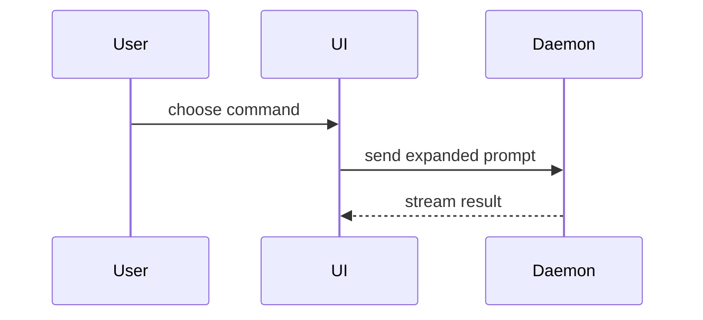

> 中文译本，仅供人阅读，**不具权威性**；以英文原文为准。
> 权威版本：`.agents/skills/pr/SKILL.md`
> 对应上游 hash：`a66195583d0f9323`
> 来源：`mattpocock/skills`

# PR 正文（pr）

> 出自 `show-me` skill，作者 Dex Horthy（Humanlayer）：
> https://github.com/humanlayer/skills/blob/main/plugins/show-me/skills/show-me/SKILL.md

用这个模板写 PR 正文：

```markdown
## 摘要

<图示、diff 草图、或树形结构>

## 证据

- **改前：** <截图 / 输出 / 失败的测试运行>
  **改后：** <截图 / 输出 / 通过的测试运行>

## 合并风险

**门型（Door）：** <单向门（one-way door） 或 双向门（two-way door）>

<可选：说明>

**爆炸半径（Blast Radius）：** <一个词>

<可选：合并可能带来的后果>
```

## 各小节

跳过一切前言，行文要短。使用 `GLOSSARY.md` 里用户的领域语言。

### 摘要

挑**能说清重点的最小视图**。

- 把逻辑或算法表示为伪代码：

```text
on(save)
  if content is unchanged
    return cached result
  write new content
  return fresh result
```

- 把运行时控制流表示为调用树：

```text
submitForm
  createSession
    persistPrompt
    launchAgent
  navigateToSession
```

- 把 UI 结构表示为组件树，包括重要的状态（state）与模块（module）边界：

```text
<SessionPage> (apps/example/src/routes/session.tsx)
  useSessionEvents()
  <SessionToolbar>
    <RunSkillButton> (packages/ui)
```

- 把文件职责或大范围重构（wide refactor）表示为浅层文件树：

```text
src/
├── commands/       # 解析用户动作
├── sessions/       # 持有会话状态
└── transport/      # 发送 API 请求
```

- 用 Mermaid 表示组件交互、控制流或数据流：



- 当重点是「变了什么」且周边形状已经存在时，用 `diff`。diff 的形状要配得上主题。

组件改动：

```diff
 <SessionPage>
   useSessionEvents()
   <SessionToolbar>
+    <RunSkillButton />
   <SessionTimeline>
+    <SkillResultCard />
```

文件布局改动：

```diff
 src/
 ├── commands/
+│   └── show-me.ts       # 展开 slash 命令
 ├── sessions/
-└── transport.ts
+└── transport/
+    ├── client.ts
+    └── stream.ts
```

调用树或调用栈改动：

```diff
 submitForm
   createSession
     persistPrompt
+    expandSkillMention
     launchAgent
-  navigateToSession
+  navigateToSession
+    subscribeToEvents
```

状态或控制流改动：

```diff
 on(save)
-  write content
+  if content is unchanged
+    return cached result
+  write new content
+  invalidate cache
```

- 当大部分内容是新的、省略的上下文会藏起归属或顺序、或用户需要一个可直接复制的目标形状时，就整块展示：

```ts
function expandSkill(command: string): string {
  const skillName = command.slice(1);
  return `use the ${skillName} skill`;
}
```

#### 指引

每个图示都紧贴着它支撑的那段短文。只保留回答用户当前问题（或当前讨论点要比较的选项）所必需的调用、文件、props、状态与边界。

你可以只用其中一种，也可以用几种，但不太可能全用上。自己判断，别把用户淹了。

### 证据

证明改动有效的具体证据，要展示改前与改后。

截图是 S 级 —— 当环境已就绪且改动是视觉性的。

基于执行的证据是 A 级：测试结果、console 输出。用伪代码展示那条现在失败、改后通过的测试。

### 合并风险

说明这是单向门还是双向门。双向门可以走回去，单向门不能。回滚成本低的 PR 风险更低。涉及破坏性操作或难以逆转的决策，就是单向门。

**爆炸半径**是本次 PR 引入改动可能的影响或范围。把所有可能性都想一遍，例如布局位移、对下游消费者的破坏、移动端响应式等。
